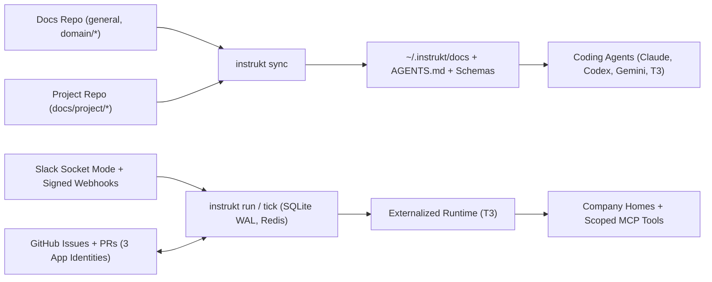

# instrukt

**Context engineering, autonomous SDLC workflows, and Business-in-a-Box standing agents — in one Rust binary.**

[](Cargo.toml)
[](Cargo.toml)
[](Cargo.toml)

```sh
curl -fsSL https://github.com/InstruktAI/instrukt/releases/latest/download/install.sh | sh
npx skills add InstruktAI/instrukt@v0.1.0 --skill instrukt -g -y
```

Tell any coding agent **"install instrukt"** and it follows these two commands — installing the verified binary and the cockpit skill ([`skills/instrukt/SKILL.md`](skills/instrukt/SKILL.md)) into every agent CLI on your machine.

- The installer verifies `SHA256SUMS`, writes **only** the `instrukt` binary (`$INSTRUKT_INSTALL_DIR` → `$XDG_BIN_HOME` → `~/.local/bin`, without touching shell profiles or `~/.instrukt`), and prints the pinned skill command for the release it installed.
- Supported prebuilt targets: `aarch64-apple-darwin` (Apple Silicon macOS), `x86_64-unknown-linux-gnu`, and `aarch64-unknown-linux-gnu`.
- Run `instrukt -h` for the full command surface, or `instrukt status` to inspect your machine and repository.

---

## Why instrukt?

**Mechanisms in Rust. Doctrine in documentation.**

Coding agents break down when instructions bloat into stale monoliths, workflows are hardcoded in prompts, or team automation turns into fragile glue scripts. `instrukt` separates durable **mechanisms** (one fast, `unsafe`-free Rust binary) from pluggable **doctrine** (versioned markdown repositories published progressively to every agent on the machine).

Start small with pure context engineering and git-committed documentation — then switch on optional modules for structural code graphs, an autonomous SDLC work record, event-driven standing agents, cross-machine session history, or multi-company Slack + MCP assistants.



---

## What's Shipped Today

### 1. Context Engineering & Pluggable Doctrine (`core`)
- **Three-position documentation model:** `docs/general/` (universal doctrine), `docs/domain/<name>/` (reusable domain policies & procedures), and `docs/project/` (project specs, designs, and references).
- **Progressive disclosure:** Agents read compact indices and fetch only the snippets they need (`instrukt docs index|get|validate|schema|render|fold`).
- **Committed-`main` publication:** `instrukt init` adopts any repository; `instrukt sync` publishes committed `main` docs into `~/.instrukt/docs/`, renders global & project agent entrypoints, emits JSON Schemas + editor modelines (`.instrukt/schemas/`), and tracks evaluation fingerprints.
- **Repository & config hygiene:** Attributed worktree commits (`instrukt repo commit`), managed git hook sections (`instrukt hooks`), use-case coverage & reservation tracking (`instrukt specs coverage|reserve|trace`), revision-checked layered YAML config (`instrukt config`), machine-local protected secrets (`instrukt secrets`), and agent profile availability (`instrukt agents`).
- **Agent-led setup:** The cockpit skill ([`skills/instrukt/SKILL.md`](skills/instrukt/SKILL.md)) and configuration skill ([`skills/instrukt-configure/SKILL.md`](skills/instrukt-configure/SKILL.md)) interview the user only for human-owned choices and configure everything through `instrukt`'s CLI.

### 2. Business-in-a-Box: Company Homes, Slack & Scoped MCP (`company` + `conversations`)
- **Folder-as-registration company homes:** Drop a company folder under `~/.instrukt/companies/<name>/` with isolated `instrukt.yaml`, `secrets.env`, member directories, and profiles ([`docs/project/spec/domain/company.md`](docs/project/spec/domain/company.md)).
- **Outbound Slack Socket Mode connector:** Handles `@agent` channel mentions and direct messages with workspace verification, live assistant status updates, offline message read-back, and config hot-reload — no inbound firewall ports required ([`docs/project/spec/feature/company/slack-connector.md`](docs/project/spec/feature/company/slack-connector.md)).
- **Scoped Streamable HTTP MCP:** Agents discover servers, inspect tools progressively, and execute calls via `instrukt mcp list|list-tools|call`, with stored per-speaker credentials and automatic output credential scrubbing ([`docs/project/spec/feature/runner/mcp-access.md`](docs/project/spec/feature/runner/mcp-access.md)).

### 3. Autonomous SDLC & Work Record (`todos`)
- **Local-leading work record:** SQLite WAL state (`instrukt todo`) reflected to GitHub Issues with dependency tracking, holds, and structured approvals ([`docs/project/spec/domain/work.md`](docs/project/spec/domain/work.md)).
- **Role-separated GitHub App identities:** Distinct project, author, and reviewer bots keep authorship and independent review honest ([`docs/project/spec/feature/work/github-apps.md`](docs/project/spec/feature/work/github-apps.md)).
- **Evidence-bound gates & standing integration:** Cryptographically bound review stamps, CI-gated standing `integrate` agent, log bug-hunter dispositions (`instrukt bugs`), and workflow evaluation metrics (`instrukt eval report`).

### 4. Event-Driven Standing Agents & Externalized Runtime (`events` + `runner`)
- **Single runner, externalized execution:** `instrukt run` and OS-scheduled `instrukt tick` coordinate standing and dispatched agents on top of **T3** without reimplementing an agent harness ([`docs/project/spec/feature/runner/t3-contract.md`](docs/project/spec/feature/runner/t3-contract.md)).
- **Event bus & signed webhook ingress:** Scoped Redis Streams, producer-declared event schemas (`instrukt events`), signed loopback webhook receiver (`instrukt webhooks serve` at `/hooks/inbound/...`), live native thread links (`instrukt discuss open|close`), and active session inspection (`instrukt sessions`).

### 5. Structural Code Graphs & Cross-Machine History (`blueprint` + `history`)
- **Codebase graphs (`blueprint`):** Structural impact analysis, dependency path queries, and use-case traceability (`instrukt blueprint affected|path|query|explain|status`).
- **Retained conversation history (`history`):** Extract, import from TeleClaude (`instrukt history import-teleclaude`), and full-text search across machines via SQLite FTS5 + cluster Redis (`instrukt history search|show`).

---

## Modular Architecture

Enable only what a machine or project needs via `instrukt config patch` and `instrukt install`:

| Module | Default | What it provides | Key CLI entrypoints |
| --- | --- | --- | --- |
| **`core`** | Always on | Docs taxonomy, progressive disclosure, publication, git hooks, specs, config, secrets | `init`, `sync`, `docs`, `specs`, `hooks`, `repo`, `config`, `secrets`, `agents`, `status` |
| **`history`** | On | Cross-machine conversation extraction, import, and FTS5 + Redis full-text search | `history extract`, `history import-teleclaude`, `history search`, `history show` |
| **`blueprint`** | Opt-in | Structural codebase graph, blast radius, path queries, and use-case trace | `blueprint affected`, `path`, `query`, `explain`, `status` |
| **`todos`** | Opt-in | Local-leading work record, GitHub reflection, stamps, approvals, standing integration | `todo`, `bugs`, `eval` |
| **`events`** | Opt-in | Event bus, Redis Streams, webhook ingress, event-driven standing procedures | `run`, `tick`, `ticks`, `events`, `webhooks`, `discuss`, `sessions`, `install` |
| **`conversations`** | Opt-in (per company) | Company homes, Slack Socket Mode connectors, scoped Streamable HTTP MCP | `mcp list`, `mcp list-tools`, `mcp call` |

---

## Doctrine Comes From a Docs Repository

`instrukt` ships no baked-in doctrine of its own. The principles, policies, procedures, and workflow definitions agents follow live in ordinary git repositories whose `docs/general/` and `docs/domain/<x>/` folders are adopted with `instrukt init`. `instrukt sync` publishes their committed `main` into `~/.instrukt/docs/` on the machine so every project there can read them.

This repository currently publishes `general` and `sdlc`; fork it, override it, or adopt additional domain repositories ([`docs/project/spec/feature/publication/docs-repositories.md`](docs/project/spec/feature/publication/docs-repositories.md)). Until the default doctrine is split into its own repository, `InstruktAI/instrukt` serves as that docs repository.

---

## Landing Now & Roadmap

### Landing Now *(active branches in review)*
- **Unified prose-routed `todo-orchestrator`:** Replaces the multi-state YAML state machine with a facts-only ledger and a single standing orchestrator per project driven directly by published lifecycle procedures.
- **Company Self-Service MCP Connections & Built-In OIDC Issuer:**
  - Interactive per-speaker browser OAuth (`speaker_login: sign-in`, PKCE `S256`, DM sign-in links, `instrukt mcp sign-out`).
  - Host-level shared OAuth clients (`mcp_clients.<name>`), live OAuth/OIDC/EMA discovery (`instrukt mcp discover`), and ingress boundary checks (`instrukt mcp check-ingress`).
  - Company-admin DM self-service for wiring new MCP tools without touching server files.
  - Lightweight built-in per-company ES256 OIDC issuer (`instrukt mcp issuer init|show`) for connecting self-hosted apps without running Keycloak.

### Coming Next *(roadmap)*
- **Named Company Personas (`@coder` alongside `@agent`) & Direct T3 Access:** Generic multi-connector company routing (`connectors.<name>` with `kind`, `role`, `admit: admins_only`, `session_scope: company`, and `reply_mode: explicit` + `instrukt company reply`) so a company's technical coordinator shares context across DMs and channels without leaking internal monologue — while admins can also open and steer any standing agent thread directly in **T3**.
- **Multi-Company Linux Container Isolation:** Rootless per-company container isolation for safely hosting multiple companies on one host ([`docs/project/spec/feature/runner/company-containers.md`](docs/project/spec/feature/runner/company-containers.md)).
- **Pluggable External Domains & Standalone Doctrine Repo:** Adopting external business and deployment domains (such as `itsup` and `erpnext`) alongside `sdlc`, and splitting the default doctrine out of the binary repository.

---

## Architecture & Workspace

The repository is documentation-first. Start with:
- **[Context Map](docs/project/spec/domain/context-map.md)** — bounded contexts, domain boundaries, and invariants
- **[Architecture Overview](docs/project/design/architecture/overview.md)** — crate topology, state ownership, and runtime boundaries

One Cargo workspace (`edition = "2024"`, MSRV `1.89`, `unsafe_code = "forbid"`), producing one binary `instrukt`:

| Crate | Responsibility |
| --- | --- |
| [`crates/instrukt-cli`](crates/instrukt-cli) | Binary entrypoint and 24-command `clap` CLI surface |
| [`crates/instrukt-core`](crates/instrukt-core) | Docs taxonomy, publication, config, secrets, git hooks, repo commits, specs |
| [`crates/instrukt-blueprint`](crates/instrukt-blueprint) | Structural code graph generation, blast radius, and queries |
| [`crates/instrukt-runner`](crates/instrukt-runner) | Event bus, ticks, T3 runtime adapter, webhooks, history, MCP client, session links |
| [`crates/instrukt-todos`](crates/instrukt-todos) | SQLite WAL work record, GitHub App reflection, stamps, approvals, workflow & eval |
| [`crates/instrukt-connector`](crates/instrukt-connector) | Shared connector contract and ingress/egress traits |
| [`crates/instrukt-company`](crates/instrukt-company) | Company home registry, members, profiles, and conversation routing |
| [`crates/instrukt-connector-slack`](crates/instrukt-connector-slack) | Outbound Slack Socket Mode connector |

---

## Development

```sh
make hooks          # once per clone: pre-commit runs the checks the staged files need
make commit-checks  # every commit check over every file, as CI runs it
make check          # lint, the whole test suite, coverage and the audit by hand
```

- Commit checks use the `pre-commit` framework at the version pinned in [`scripts/test-tools.env`](scripts/test-tools.env) (`uv tool install pre-commit==<version>`). [`.pre-commit-config.yaml`](.pre-commit-config.yaml) maps each check to its files; the full functional suite runs in CI on every pull request.
- Python lint and type checks use the framework's pinned `ruff` and `mypy` hooks. `make hooks` populates `~/.cache/pre-commit` (requires network access); committing before running `make hooks`, or after a pinned tool updates, installs what it needs automatically. The first run after a tool install is slower once per installation, not once per checkout.
- Command-line integration tests run the compiled binary against isolated temporary `HOME` directories and temporary git repositories ([`crates/instrukt-cli/tests/common`](crates/instrukt-cli/tests/common)); they never touch your live home or agent settings.
