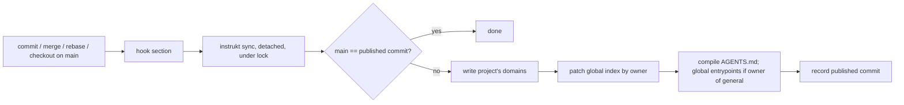
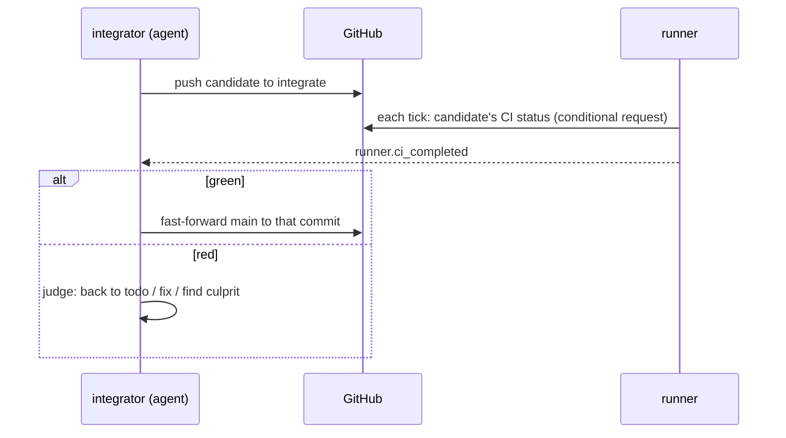

# Architecture Overview — Design

## Purpose

instrukt is a context-engineering module: a single
CLI that makes documentation the way agents are instructed and, when switched
on, runs the work those docs describe. It has no daemon and no API. Every
behavior is a command that starts, does its work against files, git, GitHub or
a runtime, and ends; whatever must happen later is triggered by git hooks, the
operating system's scheduler, or an event delivered to a command.

The modules and their bounded contexts are listed in
`local/projects/instrukt/spec/domain/context-map`; each context's model is its
domain spec. This design holds what spans them: the shape of the binary, the
home, and the flows.

## Inputs/Outputs

### Modules and crates

| Module | Contexts | Switch | Needs |
| --- | --- | --- | --- |
| `core` | docs, configuration, publication, repository, specs | always on | files, git |
| `blueprint` | blueprint | on/off | a graph engine adapter |
| `todos` | work, workflow; the runner dispatching todos | on/off; `runner.autostart` | GitHub, a runtime mapping |
| `events` | the runner's event sources and standing agents | on/off | a runtime mapping |

One Cargo workspace, one binary `instrukt`. Crates: `instrukt-cli`,
`instrukt-core`, `instrukt-blueprint`, `instrukt-runner` (the runner context,
shared by `todos` and `events`), `instrukt-todos`. Dependencies point one way:
`instrukt-cli` → the others; `instrukt-todos` → `instrukt-runner` →
`instrukt-core`; `instrukt-blueprint` → `instrukt-core`; `instrukt-core` →
nothing of instrukt. Where core needs an answer only an optional module has
(whether a todo slug named by a pending doc exists), core declares the
interface and the CLI wires the module's implementation in only when that
module is on. Eval is not a module: stamps always carry model, version and eval
fingerprint, and reporting is `instrukt eval report`, which builds an HTML report from the
record, together with the flavor's activatable report procedure that tells an
agent when and how to run it and what to say about it.

The runner declares interfaces for reading and mutating work items through
work’s command contract: recording and reflecting claims, flushing pending
reflection, recording last-fired stamps, setting automatic holds, purging expired
retained records, and reading and writing per-role session bindings. It also
declares an interface for reading workflow state. The todos crate implements
these contracts; the CLI wires them into the runner. Todo dispatch is realized
in the runner against those interfaces, preserving todos → runner → core.
Core likewise declares the hook-generation interface; the CLI wires blueprint
into it when enabled. Core declares the todo-existence and flavor-role lookup
interfaces, wired by the CLI to todos only when enabled.

### The home

`~/.instrukt` is fixed and is not a git repository. Everything in it is
re-creatable, except local work-record writes not yet reflected to GitHub,
which are lost if the home is deleted.

| Path | Holds | Re-created from |
| --- | --- | --- |
| `instrukt.yaml` | the global configuration layer (runtime mapping, agents' git authors, module switches, runner settings) | the user |
| `docs/` | published snippets and `workflow/` flavor files per domain, per-domain `publisher.yaml` and `bundle.md` | each project's committed main, by `sync` |
| `docs/index.yaml` | the global index, every entry carrying its owning project; local entries carry the absolute path of the file in their project | each project's `sync` |
| `state/publication/` | per project, the commit last published and the project's checkout path | `sync` |
| `state/hooks/<project>/` | each hook section's last run outcome, shown by `instrukt hooks status` | the next hook run |
| `state/runner/` | the event log with per-consumer cursors, conditional-request validators, standing-agent session bindings, the runner lock, the last wake-up | the runner (events re-derived from the record where possible) |
| `state/eval-fingerprint/` | per published commit, the digest of all published `eval: true` snippets | `sync` |
| `state/blueprint/<project>/<sha>/` | the latest complete graph and the one before it, per remote-main revision | the next push or pull |
| `git/<host>/<owner>/<repo>/` | ingested external repositories with their `index.md` and `history.md` | a fresh clone |
| `state/work/` | the local work record (pull-through of GitHub) | GitHub |
| `state/machine-id` | this computer's id, created once; the holder of its claims | re-created on first use (deleting it orphans this computer's live claims until they are released) |

A project carries `instrukt.yaml` (the project layer), `docs/global/` (what it
publishes), `docs/local/` (its own docs), `AGENTS.master.md`, and instrukt's
marked sections in its git hooks. No index file lives in a repository.

### Common CLI surface

Every public command accepts `--help` and prints its own command and flag
contract without executing its operation.

### External surfaces

| Surface | Used by | How |
| --- | --- | --- |
| git | publication, repository, blueprint, workflow, runner | the `git` CLI; hooks |
| GitHub | work, workflow, runner | its API (address configurable, `github.api_url`) through one writer per computer |
| Supported agent CLIs | publication | entrypoint files and the entrypoint-loading settings each requires |
| Configured runtime | runner | the runtime mapping's commands |
| Configured graph engine | blueprint | an adapter emitting the node-link contract |
| OS scheduler | runner | `instrukt tick` each minute |

## Invariants

- **No daemon.** No process of instrukt outlives the work it was started for,
  except `instrukt run` when a user chooses a long-lived runner; nothing
  depends on one running.
- **Each project publishes only its own part.** Publication never reads
  another project's repository; the global index is patched by owner, never
  rebuilt from all sources. Reading is different: `docs get` reads another
  project's local doc from the path its index entry carries, because local
  content stays in its project.
- **Committed state is the source.** Publication reads a project's committed
  main, never its working tree; the blueprint is generated for a pushed
  revision.
- **The record is the state.** The workflow engine stores no phase; it derives
  state from the record on every call.
- **Main is green by construction.** Only the integrator moves main, and only
  to a commit whose checks passed.
- **Git hooks belong to everyone.** instrukt touches only its marked section,
  never uses `exec`, and never blocks git after the fact.
- **A cloned repository does not decide what runs on a machine.** The runtime
  mapping lives only in the global layer, and so does the command form of
  `blueprint.engine`; a project layer may only name a shipped adapter.
- **Agents read; instrukt computes.** Freshness, ownership and state are
  instrukt's to compute; agents consume answers that name what they reflect
  (a SHA, a version).

## Primary flows

### Publish

### Read

`instrukt docs index` shows all domains plus the local docs of the project the
caller stands in; `instrukt docs get` resolves ids to paths, follows required
reads, and resolves `@config` directives in-process at read time — which is
how session-bound values (`<!-- @config: runtime.conversation -->`) reach a
snippet. No snippet runs a command.

### Push and map

A graph exists for every remote-main revision a machine gets: the pre-push
section sees its own push to `main`, and a pull that moves main (post-merge,
post-rewrite) brings another; each records the SHA and starts generation
detached, so git never waits. How generations are serialized, stored and chosen is the blueprint context's
(`local/projects/instrukt/spec/domain/blueprint`); answers always name the SHA
they reflect.

### Integrate

Branch protection with required checks refuses any push of main to a commit
without a green result. A project without CI gets the same gate locally: the
integrator runs the project's `test` action on the candidate, and only a
passing candidate is fast-forwarded onto main.

### Run

The runner (`instrukt run`, or `instrukt tick` from the OS scheduler) does what
the switched-on modules need: it dispatches todos (when `runner.autostart`),
and starts or wakes standing agents on events. It reaches a runtime only
through the sessions facade (`instrukt sessions run|send|alive|conversation`).
A step is done when the record carries its artifact and stamp, never when a
session's reply says so. Whatever needs the human is a session asking in its
thread; only anomalies are sent through `runner.notify`.

## Failure modes

- **A hook did not fire** (a reset): the next `sync` from any trigger catches
  up, because it compares main with the published commit; `docs get` warns
  when publication is behind main, and `instrukt sync --force` republishes on
  demand.
- **Committed docs fail validation:** `sync` publishes nothing for that commit;
  the previous publication stays, and `instrukt hooks status` shows the
  refusal.
- **Two projects claim one domain:** the second `sync` is refused and names the
  owner; the published tree is unchanged.
- **A hook manager regenerated a hook file** and dropped instrukt's section:
  `instrukt hooks status` reports it and prints the line to add to that tool.
- **Graph generation fails or is interrupted:** the previous complete graph
  stays; answers keep naming its SHA.
- **GitHub unreachable:** work continues against the local record; reflection
  resumes when GitHub is reachable.
- **Main turns red anyway:** the integrator reverts the culprit first and
  repairs it in its own todo.
- **A runtime is not configured or no session variable is set:** `runtime.*`
  fails with a clear error; commits get no `Session:` trailer rather than a
  guess.
