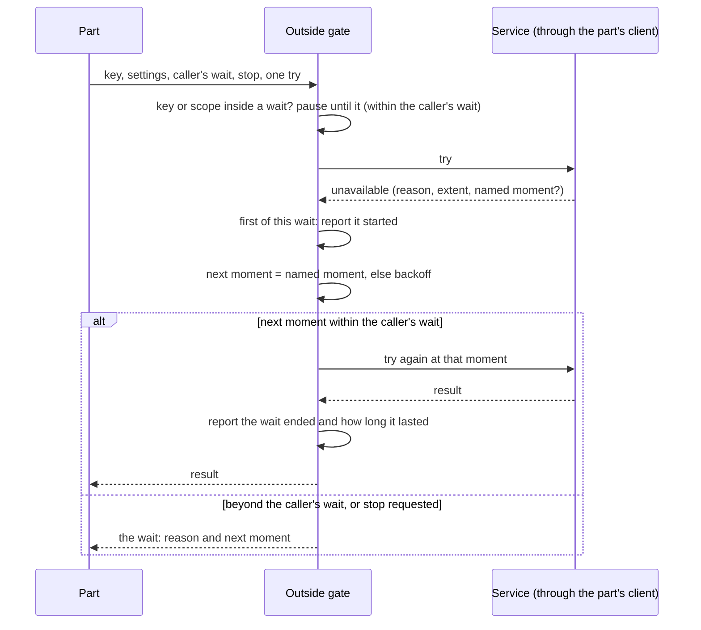

# Outside Gate — Design

## Required reads

- [project/instrukt/design/architecture/overview](overview.md)

## Purpose

Long-lived daemon loops that talk to external services across repeated passes
or transports (such as company connectors, the conversation relay, and
background runner pollers) use the outside gate to coordinate availability. The
gate turns what the service said into a judgment — temporarily unavailable or a
defect — holds shared in-process cooldowns across callers of the same scope or
key, decides when the next try may happen, and tells the operator once per
outage episode.

The gate governs availability for long-lived daemon loops, not transport and
not one-shot CLI invocations. Each caller talks to its service through an
established off-the-shelf SDK, protocol client, or CLI
(`sdlc/policy/substrate-anchoring`) and never wraps or fights an SDK just to
route through the gate. One-shot CLI commands exit immediately (so an
in-process wait table carries no cross-call value) and use their client
directly with ordinary error handling. HTTP status semantics are one adapter of
the gate.

The term is always "the outside gate". "Gate" alone refers to an entry or
integrity check that refuses with its door (`general/principle/trust-and-guardrails`).

## Inputs/Outputs

### Where it lives

The crate `instrukt-outside`, which depends on nothing of instrukt
(`project/instrukt/design/architecture/overview`, Modules and crates).

### Key and extent

A part names what a call reaches by a key: a service name the operator
recognises (`slack`, an MCP server's declared name), the scope it reaches (such
as a company and a connector), and optionally what within that scope the call
uses (such as a Web API method). A temporary unavailability applies to one of
three extents, as the service's answer says:

- **the scope**: the service cannot be reached or says it is unavailable;
- **the key**: what within the scope the call used, such as a method the
  service limited;
- **the call**: only the request that received it, which the service says it
  could not complete; it says nothing about any other request.

The gate keeps waits for the scope and the key: a call is not tried while its
scope or its own key is inside a wait, and a wait on one key never delays
another key of the same scope. A failure of the call holds back no other call;
the part that made it receives a wait whose moment follows its key's backoff
and paces its own next try by it.

### The judgment a part's adapter gives

One try through the part's own client ends in its result or in a failure
classified as:

- **temporarily unavailable**: a reason from a closed vocabulary — unreachable,
  timed out, rate limited, unavailable as the service said, or a refusal the
  part's service rules count as temporary — its extent, and the moment the
  service named for the next try when it named one;
- **a defect**: anything else. A defect is never retried by the gate and
  returns to the part unchanged.

### Settings

A part's settings for its calls, each with the gate's default when it brings
none:

- **backoff**: the first and the longest pause when the service named no
  moment; pauses double from the first to the longest and start again from the
  first after a success;
- **service rules**: what counts as temporarily unavailable for this service
  beyond the protocol's standard, applied before the standard rules. A service
  rule decides whether an answer is temporary, its reason and its extent; a
  moment the answer names still sets the next try.

### Operations

- **Attempt** — one try at most, never a pause. A key or scope inside a wait is
  not tried. Answers the result, the defect, or the wait: its reason and the
  moment of the next possible try. Used by a part that must not block, such as
  a pass of a long-running loop, and by every call whose repetition is not
  safe.
- **Call** — for a call whose repetition is safe, in a part that may wait.
  Takes, beside the settings, the caller's wait — until the service returns, or
  within a stated duration — and a stop request. Tries, and after a temporary
  unavailability pauses until the next moment and tries again. Answers the
  result, the defect, or — when the next moment falls after the caller's wait or
  stop is requested — the wait, at once, without pausing into it.

A try brought to an attempt or a call makes its request through the part's own
client, never through another operation of the gate, so each failure is judged
once and reported once.

The wait a part receives renders as the operator sees it: the service, the
reason and the moment of the next try. A part that records a cause records
that rendering.

### The HTTP adapter

For a client speaking HTTP, the gate's adapter classifies a response or a
transport failure the part's service rules left unjudged:

| Answer | Judgment | Extent |
| --- | --- | --- |
| `429 Too Many Requests` (RFC 6585) | rate limited | the key |
| `503 Service Unavailable` (RFC 9110) | unavailable | the scope |
| `408 Request Timeout`, `425 Too Early`, `500 Internal Server Error` | unavailable | the call |
| `502`, `504`, any other `5xx` | unavailable | the scope |
| any other `4xx` | defect | — |
| name not resolved, connection not opened | unreachable | the scope |
| timeout or broken connection after sending | timed out / unreachable | the scope |

`Retry-After` (RFC 9110) is read on every answer judged temporarily
unavailable, whether a service rule or the table judged it, in both forms: a
number of seconds, counted
from the moment the answer was received and rounded up to whole seconds, or an
HTTP-date in any of the three formats RFC 9110 requires a recipient to accept.
An unreadable value is treated as absent. A moment too far to represent is
taken as the farthest representable one.

## Invariants

- **The service's word governs.** Where the service names a moment, the next
  try is not before it and is allowed at it. Otherwise the pause follows the
  part's backoff.
- **One report per wait.** While a key or a scope is waited on, the operator is
  told once: when its first unavailability starts the wait, and when a try at
  that level next succeeds, with how long the wait lasted. A failure of the
  call is reported on its key the same way, without holding the key. No record is written
  per try. The report names the service, the key or scope, the reason and the
  moment of the next try, and never a credential, a request body or an answer
  body.
- **A named moment holds on the host's clock; a pause runs on a monotonic
  clock.** A wait's moment is fixed when the wait starts, on the clock of the
  gate's host: the clock at the answer's receipt plus the delay the service
  named, the date it named, or the clock at the failure plus the pause. A wait
  the service named lasts until the host's clock reaches its moment. A backoff
  pause is measured on a monotonic source the host supplies, so a frozen or
  adjusted host clock never holds a pause open.
- **Bookkeeping holds nothing shared.** The gate holds its own state only to
  read or record one key, never across a try or a pause.
- **The host makes the gate.** The host of the parts makes the gate and hands
  it to them, so every client of one service in a process shares its waits.
  Nothing is a global.

## Primary flows

### A call that may wait

### An attempt

A pass asks for one try. A key or scope inside a wait is answered with the wait
without a try. Otherwise the try runs and its outcome is judged and recorded as
in a call, with the same report. The part schedules its next pass for the
moment it received and serves other work meanwhile.

### Where the report goes

The report is written to the log of the command the gate runs in, under the
gate's own event names (`project/instrukt/spec/feature/configuration/logging`).
A command run in the foreground also shows it on its standard error. A status
surface that shows a part's state, such as `instrukt events status`, shows the
wait the part received; it is not a second report.

## Failure modes

- **The service returns during a pause:** the gate notices at the next try, at
  most the longest pause or the named moment later.
- **The process restarts during a wait:** waits live in the process. The first
  try after a restart reaches the service, unless the part kept the moment it
  received in its own durable record and does not try before it.
- **An adapter classifies a defect as temporary:** the gate waits it out, and
  the report shows the reason; the adapter is corrected.
- **A call whose repetition is not safe fails with its effect unknown:** the
  part receives the wait from an attempt and reconciles through its own record
  of the effect (`sdlc/policy/state-storage`).
- **The caller's wait is shorter than the outage:** the caller receives the
  wait within it (`sdlc/principle/architectural-defaults`).
