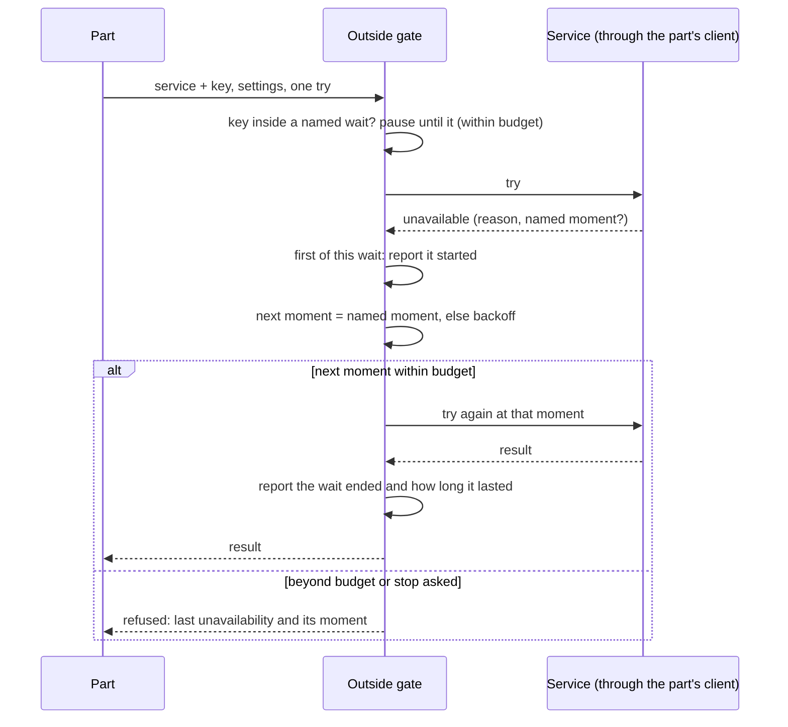

# Outside Gate — Design

## Required reads

- [project/instrukt/policy/checks-and-guards](../../policy/checks-and-guards.md)

## Purpose

instrukt depends on services outside it: GitHub, Slack, declared MCP servers
and their sign-in issuers, Redis, the selected runtime, model endpoints. Each
can leave at any moment, and each tells its caller something when it does. The
outside gate is the one place where instrukt turns what a service said into a
judgment — temporarily unavailable or a defect — decides how long to wait
before trying again, and tells the operator once that it waits and why.

The gate governs availability, not transport. A part talks to its service
through the best existing client for it: an HTTP client, a protocol client, an
SDK, a command-line program. The gate never asks a part to replace a fitting
client with hand-written requests. The client's outcome is brought to the gate,
and the gate decides what happens next. HTTP status semantics are one adapter
of the gate, not a requirement on callers.

The term is always "the outside gate". "Gate" alone keeps its meaning in
`project/instrukt/policy/checks-and-guards`: an entry check that refuses with
its door.

## Inputs/Outputs

### Where it lives

The gate is the crate `instrukt-outside`, which depends on nothing of
instrukt. Every crate that talks to an outside service depends on it, the
connector crates included, so its interface is reachable from every part
without reversing a dependency between instrukt's crates
(`project/instrukt/design/architecture/overview`).

### What a part gives the gate

- **The service and the key it is waited on by.** A service name the operator
  recognises (`slack`, `github`, an MCP server's declared name) and a key
  narrowing it to what one wait applies to, such as a company, a connector and
  a method. Waits are kept per key, so a wait on one key never delays another.
- **The operation.** One try against the service through the part's own
  client. It answers with its result, or with a failure the part's adapter has
  classified as one of:
  - **temporarily unavailable**, with the reason from a closed vocabulary
    (unreachable, timed out, rate limited, the service saying it is unavailable
    with its status, or a refusal the part's service rules count as temporary),
    the moment the service named for the next try when it named one, and
    whether the request is known not to have taken effect;
  - **a defect**: anything else — a refusal of the request, a request instrukt
    built wrongly, an answer of the wrong shape. A defect is never retried.
- **Its settings for this request**, each with the gate's default when the part
  brings none:
  - **budget**: how long the caller may wait in all — until the service
    returns, within a stated duration, or a single try whose outcome is only
    judged and reported;
  - **backoff**: the first pause and the longest pause between tries when the
    service named no moment;
  - **effect**: whether repeating the operation is safe. An operation whose
    repetition is not safe is tried again only after a failure known not to
    have taken effect; after any other failure the gate hands the outcome back
    to the part, which owns the intent record of that effect
    (`sdlc/policy/state-storage`);
  - **service rules**: what counts as temporarily unavailable for this
    service beyond the protocol's standard, such as a vendor's own throttling
    signals, or a refusal the part's own contract says is waited out, such as
    a connection whose credential the operator may still renew. The part's
    adapter supplies them; the gate applies them before the standard rules.

### What the gate gives back

- **For a part that may wait** (a command, a part with its own thread): the
  result, or a refusal — the defect, or the last unavailability once the
  budget would be exceeded or the part asked the wait to stop. The gate never
  sleeps past the budget: when the next try would fall after it, it refuses at
  once with the moment the service named or the backoff gave.
- **For a part that must not block** (a pass of a long-running loop): the
  result, the defect, or the moment before which the key is not to be tried
  again. A key still inside a wait the service named is not tried at all; the
  part is told the moment and moves on.

### The HTTP adapter

For a client speaking HTTP, the gate's HTTP adapter classifies an answer by
the protocol's standards before any service rule:

- `429 Too Many Requests` (RFC 6585) and `503 Service Unavailable`
  (RFC 9110 §15.6.4) are temporarily unavailable and known not to have taken
  effect; `408 Request Timeout` and `425 Too Early` are temporarily
  unavailable; `502` and `504` are temporarily unavailable with their effect
  unknown; every other `4xx` is a defect; any other `5xx` is temporarily
  unavailable with its effect unknown.
- `Retry-After` (RFC 9110 §10.2.3) is read in both of its forms, a number of
  seconds or an HTTP-date in any of the three formats a recipient must accept
  (RFC 9110 §5.6.7). The gate waits exactly until that moment; a delay counts
  whole seconds from the moment the answer was received.
- A name that does not resolve and a connection that cannot be opened are
  unreachable and known not to have taken effect; a timeout or a broken
  connection after the request was sent is unreachable or timed out with its
  effect unknown.

Other client families bring their client's own classification through the
gate in the same shape — a Redis client's connection, refusal and timeout
signals, a runtime adapter's statement that its runtime cannot be reached —
so each judgment is made once, where the client's knowledge is.

## Invariants

- **One judgment.** Whether a failure is temporary, how long to wait and what
  the operator is told are decided by the gate and nowhere else. A part never
  carries a backoff schedule or a `Retry-After` reading of its own; it brings
  its settings to the gate. A part that must remember a wait across restarts
  keeps the moment the gate gave it in its own durable record, as the time of
  its next pass, and does not try before it.
- **The service's word governs.** Where the service names a moment, the gate
  waits exactly until it. Otherwise it backs off exponentially, doubling the
  pause from the part's first pause up to its longest.
- **One retry layer.** Exactly one layer tries again. A client that retries or
  backs off by itself is either configured not to, so the gate retries, or
  brought through the gate with a single-try budget, so its own retrying is
  judged and reported without being repeated. The clients instrukt uses today
  — its HTTP client, its Redis client and its WebSocket client — retry nothing
  by themselves.
- **One report per wait.** While a key is waited on, the operator is told
  once: when its first unavailability starts the wait, and when the service
  answers again, with how long it waited. No record is written per try. The
  report names the service, the key, the reason and the moment of the next
  try, and never a credential, a request body or an answer body
  (`sdlc/policy/security-awareness`).
- **Defects pass through.** A defect returns to the part at once, unchanged,
  and is the part's to report as its own failure
  (`project/instrukt/policy/checks-and-guards`: any other failure is a defect
  to fix).
- **No wait holds a shared resource.** The gate's own bookkeeping is held only
  to read or record a key's state, never across an operation or a pause, and a
  part never waits on the gate while holding the writer lock or another lock
  unrelated work takes.
- **One gate per service in a process.** The host of the parts — a command,
  or what the runner hosts — makes the gate and hands it to the parts it runs,
  so every client of one service in a process shares its waits. Nothing is a
  global.

## Primary flows

### A part that may wait

### A part that must not block

Each pass asks the gate for one try. The gate answers with the result, the
defect, or the moment before which the key is not tried; a key inside a named
wait is answered with that moment without being tried. The part schedules its
next pass for that moment and serves its other work meanwhile. The report is
the same as for a waiting part.

### Where the report goes

The gate writes the report to instrukt's log, in the log of the command it
runs in, under the gate's own event names
(`project/instrukt/spec/feature/configuration/logging`). A command run in the
foreground also shows the same report on its standard error, since its operator
is the person running it. Status surfaces that already show a part's state,
such as `instrukt events status`, keep showing the outcome the part received
from the gate; they are not a second report of the wait.

## Failure modes

- **The service answers again during a pause:** the gate does not notice
  before the pause ends; the pause is bounded by the backoff's longest pause or
  by the moment the service named.
- **The process restarts during a wait:** waits live in the process. The first
  try after a restart reaches the service, which names its wait again, unless
  the part kept the moment in its own durable record.
- **A part classifies a defect as temporary:** the gate retries it until the
  budget ends, and the report shows the reason. The adapter is corrected; the
  gate cannot tell a misclassified defect from an outage.
- **An operation whose repetition is not safe fails with its effect unknown:**
  the gate does not try again and hands the outcome to the part, which
  reconciles through its own intent record.
- **The caller's budget is shorter than the outage:** the caller is refused
  within its budget with the moment of the next possible try
  (`sdlc/principle/architectural-defaults` §10); a caller that must see the
  eventual outcome runs as its own background work with an unbounded budget.

## See Also

- [project/instrukt/design/architecture/overview](overview.md)
