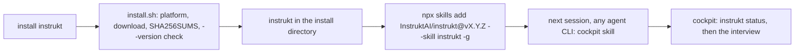
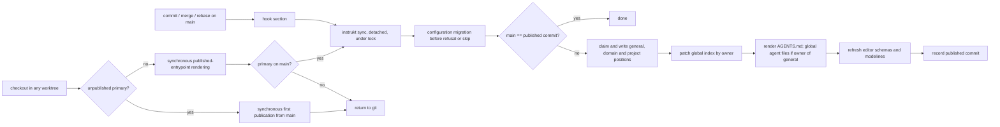
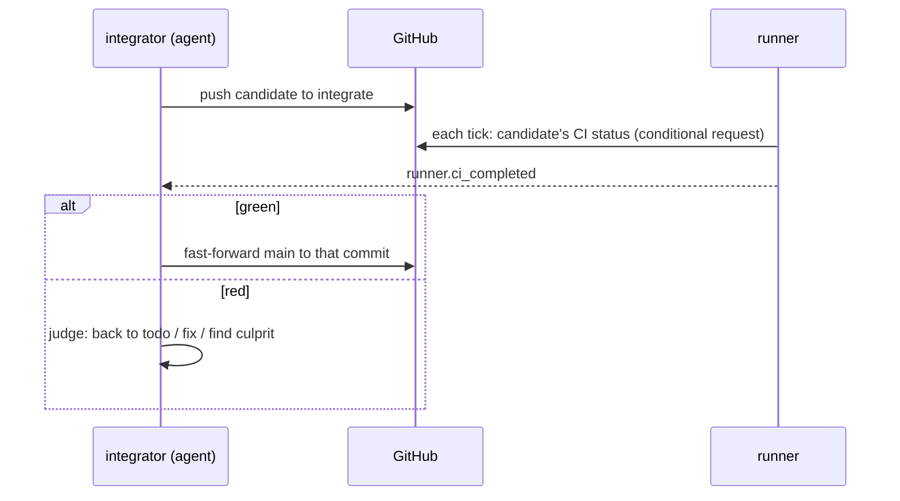
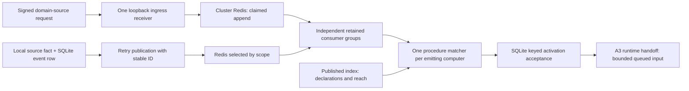

# Architecture Overview — Design

## Purpose

instrukt is a context-engineering module: a single
CLI that makes documentation the way agents are instructed and, when switched
on, runs the work those docs describe. It has no consumer daemon. Core operations are commands; enabled events also
have a narrow standalone loopback webhook receiver on the designated ingress.
Commands, independent event readers and the conversation-link stream reader
work against files, git, GitHub, scoped
Redis and the chosen runtime. Later work is triggered by git hooks, the OS
scheduler or retained events. Doctrine
comes from adopted docs repositories, not from instrukt.

The modules and their bounded contexts are listed in
`project/instrukt/spec/domain/context-map`; each context's model is its
domain spec. This design holds what spans them: the shape of the binary, the
home, and the flows.

## Inputs/Outputs

### Modules and crates

| Module | Contexts | Switch | Needs |
| --- | --- | --- | --- |
| `core` | docs, configuration, publication, repository, specs | always on | files, git |
| `blueprint` | blueprint | on/off | a graph engine adapter |
| `todos` | work, workflow; the runner dispatching todos | on/off; `runner.autostart` | GitHub, a runtime adapter |
| `history` | runner history extraction, retained search and merged queries | on by default | runtime conversation source for extraction; cluster Redis for merged search only, independently of events |
| `events` | runner sources, scoped transport, independent consumers and procedure activation | on/off | scoped Redis; selected runtime adapter for agent reactions; opt-in ingress for declared webhooks |

One Cargo workspace, one binary `instrukt`. Crates: `instrukt-cli`,
`instrukt-core`, `instrukt-blueprint`, `instrukt-runner` (the runner context,
shared by `todos` and `events`), `instrukt-todos`. Dependencies point one way:
`instrukt-cli` → the others; `instrukt-todos` → `instrukt-runner` →
`instrukt-core` and `instrukt-blueprint`; `instrukt-blueprint` → `instrukt-core`; `instrukt-core` →
nothing of instrukt. Where core needs an answer only an optional module has
(whether a todo slug named by a pending doc exists), core declares the
interface and the CLI wires the module's implementation in only when that
module is on. Eval is not a module: stamps always carry model, version and eval
fingerprint, and reporting is `instrukt eval report`, which builds an HTML report from the
record, together with the flavor's activatable report procedure that tells an
agent when and how to run it and what to say about it.

The runner declares interfaces for reading and mutating work items through
work’s command contract: recording and reflecting claims, flushing pending
reflection, recording last-fired stamps, setting automatic holds, purging expired
retained records, and reading and writing per-role session bindings. It also
declares an interface for reading workflow state. The todos crate implements
these contracts; the CLI wires them into the runner. Todo dispatch is realized
in the runner against those interfaces, preserving todos → runner → core.
Blueprint supplies its release-owned tool lifecycle to runner's module
installation; runner consumes that API rather than defining tool policy.
Core likewise declares the hook-generation interface; the CLI wires blueprint
into it when enabled. Core declares the todo-existence and flavor-role lookup
interfaces, wired by the CLI to todos only when enabled.

Core declares a caller-identity lookup interface for configuration interpolation
and commit composition. The CLI wires the explicitly selected runtime adapter
into it; the lookup reads caller context without runtime I/O. Core never imports
runner. The CLI also wires owner-supplied work/standing assignment lookup into
command admission. The native caller identifies the recorded assignment whose
role, todo, home and workspace determine scoped grants; configuration supplies
class, bundles and model/App selection from the single `roles` map. The
code-owned catalog maps instrukt operations to actions and objects. Focused
roles are enforced, standing/agent roles use awareness help and briefing, and
all callers pass object checks under
`project/instrukt/spec/feature/configuration/roles-and-capabilities`.
Recognising a caller does not select a runtime. Missing known assignment
provenance is not a roleless bypass. A bot-role commit resolves its author from
the verified App actor even without native provider-agent identity; other
unverified agent identity remains unresolved.

The shared GitHub boundary uses configured project/author/reviewer Apps and
issues installation credentials from protected key references under
`project/instrukt/spec/feature/work/github-apps`. CLI wiring supplies its
credential and verified-actor interfaces to consumers without reversing crate
dependencies. Work checks record schema versions before dependent mutation and
converts supported older envelopes; repository composes the selected bot's
noreply author. Neither introduces person/company identity bands.

### The home

`~/.instrukt` is the normal machine home and is not a git repository. The
development wrapper for instrukt itself uses an isolated home per development
worktree; installed instrukt keeps shared machine state in ordinary project
worktrees under `project/instrukt/spec/feature/configuration/owned-files`.
Committed sources recreate publication. User-owned configuration and secrets, local
history and work-record writes not yet reflected to GitHub need preservation;
deleting the home is not a lossless reset.

| Path | Holds | Re-created from |
| --- | --- | --- |
| `instrukt.yaml` | the global configuration layer (runtime choice, App public profiles and fallback identity, non-bot git authors, module switches, runner settings) | the user |
| `agents.yaml` | one role map with class, scoped `can` bundles, model order/tier and App references; typed provider-instance tier chains | shipped once, then user-owned; upgrade handling under `project/instrukt/spec/feature/configuration/agent-selection` |
| `secrets.env` | one owner-only machine-local source for all instrukt secrets, read by every path | protected secrets commands; model-provider keys remain with T3 |
| `docs/general/`, `docs/<x>/`, `docs/project/<slug>/` | the published positions: snippets, `index.yaml` and `schema.yaml` when present, and a domain's `workflow/` flavor files | the owning project's committed main, by `sync` |
| `state/index.yaml` | the global index, every entry carrying its owning project, published-file location and source checkout provenance; project entries resolve to the committed project store | each project's `sync` |
| `state/publication/` | the ownership record (the one owner of each published position); per project, the commit last published and its checkout path; the written record of each user-scope instruction file instrukt wrote | `sync` |
| `state/hooks/<project>/` | each hook section's last run outcome, shown by `instrukt hooks status` | the next hook run |
| `state/instrukt.db` | the state database (SQLite, WAL; `-wal` and `-shm` beside it): the local work record — todos and their status, artifacts and their reflection state, approvals, stamps, session bindings, pending and confirmed GitHub revisions, last known copies of the todos held elsewhere — and the runner's state — the event log with consumer cursors and handled marks, conditional-request validators, watched-ref observations, dispatched executions, standing-agent binding caches, pending delivery targets, start markers and per-key locks, conversation links and directional relay positions, held task failures, the last wake-up, and retained searchable conversations with their extraction positions and legacy import provenance; schema in `project/instrukt/spec/feature/work/state-database` | the work record from GitHub by pull-through (unreflected writes are lost); operational runner state starts empty; retained history must be preserved (only conversations still held by a source can be extracted again) |
| `state/writer.lock` | the per-computer writer lock, held only for each local state-database write transaction (the database's write-isolation unit), including migration before an older-state read; current-schema readers, network waits and reactions run outside it | taken again by the next writer |
| `state/reflection.lock` | the per-computer lock serializing GitHub reflection across requests; it briefly takes the writer lock for each local commit of what reflection learned, always in reflection → writer order; local writers release the writer lock before acquiring it and current-schema local readers take neither lock; older-state readers first take the locked migration path | taken again by the next reflection |
| `Home::history_lock_file` | serializes history extraction and one-time imports; database writer ownership remains limited to local transactions | taken again by the next extraction |
| `state/runner.lock` | the lock serializing runner invocations | taken again by the next runner |
| `state/runtime-dispatch.lock` | serializes runtime dispatch owners for one command or wake; released between long-lived runner wakes so agent-issued commands remain available | taken again by the next runtime invocation |
| `state/eval-fingerprint/` | per published commit, the digest of all published `eval: true` snippets | `sync` |
| `state/blueprint/<project>/<sha>/` | the latest complete graph and the one before it, per remote-main revision | the next push or pull |
| `git/<host>/<owner>/<repo>/` | ingested external repositories with their `index.md` and `history.md` | a fresh clone |
| `state/machine-id` | this computer's id, created once; the holder of its claims | re-created on first use (deleting it orphans this computer's live claims until they are released) |

A project carries `instrukt.yaml` (the project layer) and documentation in
three positions:

```
docs/general/       always on: rendered into every agent CLI's user-scope instruction file   ids general/<type>/…
docs/domain/<x>/    on demand: one line in the global file; rendered by `instrukt docs get --domain <x>`   ids <x>/<type>/…
docs/project/       the project: rendered into its root AGENTS.md   ids project/<slug>/<type>/…
```

Holding `docs/general/` or a `docs/domain/<x>/` is what makes a project
publish it; one project owns each on a computer, and `general`, `project` and
`third-party` (whose published tree is unchanged) are never a domain's name. Each position may carry an `index.yaml` selecting
what is rendered and a `schema.yaml` adding sections
(`project/instrukt/spec/domain/docs`). The project also carries its
root `AGENTS.master.md` (its purpose only), any nested masters, the generated
and git-ignored `.instrukt/schemas/` its YAML files' modelines name, and
instrukt's marked sections in its git hooks. No generated index lives in a
repository, and no git filter rewrites its files: references are snippet ids
the CLI resolves when read.

### Common CLI surface

Every public command accepts `-h` and prints its own command and flag
contract without executing its operation: what the command, each flag and
each setting it touches is for, and when to choose it. `instrukt -h` lists the
commands. Docs name `-h`.

### External surfaces

| Surface | Used by | How |
| --- | --- | --- |
| git | publication, repository, blueprint, workflow, runner | the `git` CLI; hooks |
| GitHub | work, workflow, runner | its API (address configurable, `github.api_url`) through one writer per computer |
| Supported agent CLIs | publication | rendered global files, never over one instrukt did not write, and the entrypoint-loading settings each requires |
| Configured runtime | runner | Rust adapter trait; compiled `t3` implementation over host `t3 thread start`, `send`, `list`, `show`, plus read-only durable T3 projection-database reads with native change notifications; explicit `runner.runtime`; unattended operations only, native agent operations rendered from runtime instruction configuration |
| Configured graph engine | blueprint | an adapter emitting the node-link contract |
| OS scheduler | runner | `instrukt tick` each minute |
| GitHub Releases | distribution | per tag: an archive per target, `SHA256SUMS` and `install.sh` |
| Agent Skills and the `skills` command (`skills.sh`) | distribution | the cockpit skill `skills/instrukt/SKILL.md`, installed into every agent CLI on the computer |

## Invariants

- **Explicit execution lifetimes.** `run` hosts long-lived independent readers;
  scheduled `tick` drains pending then new instrukt-event entries within a
  bounded invocation. Conversation links have a native-thread stream reader
  in `run`, with ordinary restart from durable per-link positions.
  The separately installed ingress receiver outlives runner downtime. There is
  no additional consumer daemon; scheduled-only reactions wait for the next wake.
- **Each project publishes only its own part.** Publication never reads
  another project's repository; the global index is patched by owner, never
  rebuilt from all sources. `docs get` reads project snippets from
  `~/.instrukt/docs/project/<slug>/…`, including another project's ids;
  source paths identify where to author, not where to read live content.
- **Committed state is the source.** Publication reads a project's committed
  main, never its working tree; the blueprint is generated for a pushed
  revision.
- **The record is the state.** The workflow engine stores no phase; it derives
  state from the record on every call.
- **Main is green by construction.** Only the integrator moves main, and only
  to a commit whose checks passed.
- **Git hooks belong to everyone.** instrukt touches only its marked section,
  never uses `exec`, and never blocks git after the fact.
- **A cloned repository does not decide what runs on a machine.** The runtime
  choice lives only in the global layer, and so does the command form of
  `blueprint.engine`; a project layer may only name a shipped adapter.
- **Owned child commands leave no descendants.** instrukt cleans each own
  child-command process group on success, failure, timeout and interruption;
  the runtime retains ownership of its agent lifecycle.
- **Agents read; instrukt computes.** Freshness, ownership and state are
  instrukt's to compute; agents consume answers that name what they reflect
  (a SHA, a version).

## Primary flows

### Install



The release installer is the one way the binary is installed or upgraded,
from any agent or none: it writes only `instrukt` into the install directory
(`$INSTRUKT_INSTALL_DIR`, else `$XDG_BIN_HOME`, else `~/.local/bin`) and
touches no profile, home or agent setting. The skill carries no binary and
upgrades none on its own; a skill and a binary of the same release share one
version. Everything set up afterwards goes through the CLI into the
configuration layers, never into the skill
(`project/instrukt/spec/domain/distribution`).

### Publish



### Read

`instrukt docs index` shows everything published plus the `docs/project/` docs
of the project the caller stands in, and `--domain <x>` narrows it to one
domain; `instrukt docs get <id>` reads a snippet naming its required reads,
`--closure` adds them transitively, each once, and `--domain <x>` renders that
domain's `index.yaml`. Every reference is a snippet id (or a bare domain name in
a required read) that the CLI resolves; `get` resolves `@config` directives
in-process at read time for configured values. Agent operations render native
instructions from the selected runtime entry; the agent carries them out in its
own conversation. The compiled adapter acts for instrukt without an agent, or
for an explicitly missing native capability. No snippet runs a command. Authoring reads and edits the source file;
`docs get` is for knowledge.

### Push and map

A graph exists for every remote-main revision a machine gets: the pre-push
section sees its own push to `main`, and a pull that moves main (post-merge,
post-rewrite) brings another; each records the SHA and starts generation
detached, so git never waits. How generations are serialized, stored and chosen is the blueprint context's
(`project/instrukt/spec/domain/blueprint`); answers always name the SHA
they reflect.

### Integrate



Branch protection with required checks refuses any push of main to a commit
without a green result. A project without CI gets the same gate locally: the
integrator runs the project's documented test command on the candidate, and only a
passing candidate is fast-forwarded onto main.

### Run

The runner (`instrukt run`, or `instrukt tick` from the OS scheduler) does what
the switched-on modules need: it dispatches todos (when `runner.autostart`), and
starts or wakes standing agents on events. It reaches a runtime only through its
Rust adapter for unattended operations. Its operational sessions surface is
`instrukt sessions list|resolve-start`; agents discover and operate conversations
through configured native instructions, recording attempts and native child ids
through work commands. Standing start-or-wake takes a
database lock per semantic key and discovers it through the selected adapter before considering a
start; the local binding is a cache. Unknown list or send results leave work
pending, and lost start replies require key recovery or explicit resolution.
instrukt derives `<slug>/prepare` or `<slug>/work`; T3 creates the corresponding
worktree from main and refuses an existing local phase branch. Work on another
computer creates its local `<slug>/work` branch from `origin/<slug>/work`. Native shared children use that recorded
workspace serially and commit directly on the todo branch; completion stamps
release attempts atomically. Preparation uses `<slug>/prepare`, reviewed and integrated immediately before a
separate `<slug>/work` starts from updated main. The integrator removes the
preparation worktree and deletes its branch locally and on origin. Ad hoc work
uses its own reviewed one-off worktree; main is integrator-only.
Before dispatch each tick, the runner fetches canonical remote main and
fast-forwards a clean canonical checkout when it lags. Post-merge publication
and blueprint maintenance run on each computer; dirty or diverged checkouts
are reported and preserved. No integrator-owned local sync or main-ahead event
is needed. New phase branches use freshly fetched origin/main.
Session ending remains the runtime's responsibility. A step is done when the
record carries its artifact and stamp, never when a session's reply says so.
Whatever needs the human is a session asking in its thread; only anomalies are
sent through `runner.notify`.

Procedure activation is durably accepted before runtime execution. The adapter
supplies procedure-first assignment and untrusted event data through bounded
logs with one session-wide waiting slot. T3 realizes ASAP through queued input;
only-at-entry delivery waits for observed idleness. Standing T3 threads remain
unsettled under automation; a human-settled thread stays reachable and wakes
on its next message.

### Conversation links

The runner's conversation aggregate and identity-envelope vocabulary live in
`project/instrukt/spec/feature/runner/conversation-links`, indexed by its domain
spec. General reading discipline is `general/policy/message-identity-headers`.
The runtime adapter supplies read-only native conversation changes and target input; work owns
only the existing state database's file, migrations and writer boundary. No
additional bounded context or process is introduced.

An independent reader in long-lived `instrukt run` follows each linked T3
thread through the adapter's read-only conversation source, with per-conversation
fingerprints and native database change notifications. The reader uses no T3
session token and owns per-link positions independently of history. Runner
admission and delivery use
recorded assignments and native identities. Native turn completion releases
recorded conversational content to the peer in identity envelopes. Link and
per-direction progress commit in the existing database, outside native network
waits; ordinary startup resumes retained positions. Relay failure is visible in
`instrukt events status` and logs. This reader has no scheduled tick path or
periodic fallback. Redis remains transport only.

### Event platform



Ingress addresses `/hooks/inbound/project/<slug>/<domain>`. The project
`webhooks.<domain>` declaration selects secret references, verification
(native, GitHub or generic HMAC-SHA256) and exactly one event-name source:
native `{name, payload}`, `name_from`, fixed `name` or GitHub normalization.
The event type is `<domain>.<name>` and its subject identifies that domain and
project; `inbound_verify` retains protocol provenance. Undeclared domains have
no endpoint. Company/person intake remains unavailable.

Local commit and stream acceptance are separate. Existing event rows supply a
retryable publication handover; ingress accepts only after cluster append or a
recognized source-scoped duplicate. Redis groups own transport positions and
bounded replay. SQLite retains local settled accounting, seven-day occurrence
marks and keyed activations. Consumer outcomes commit before Redis ACK; neither
is a business-effect completion. Ordered retries park persistently failing events
with evidence and announcement before ACK, independently of other consumers.

Subscription validation belongs to docs, registration/index replacement to
publication, selection and acceptance to runner. Only the emitting computer
activates; external procedures run on ingress and unavailable homes fail there.
Runtime delivery retains procedure-first briefing, untrusted event provenance and
session-fixed timing through A3's bounded batch log.

## Failure modes

- **A hook did not fire** (a reset): the next `sync` from any trigger catches
  up, because it compares main with the published commit; `docs get` warns
  when publication is behind main, and `instrukt sync --force` republishes on
  demand.
- **Committed docs fail validation:** `sync` publishes nothing for that commit;
  the previous publication stays, and `instrukt hooks status` shows the
  refusal.
- **Two projects claim one domain, or `docs/general/`:** the second `sync` is
  refused and names the owner; the published tree is unchanged.
- **A user-scope instruction file instrukt did not write:** the `general`
  owner's `sync` stops before publishing and names the file; moving its
  content into docs, or the file out of the way, and syncing again is the
  door.
- **A hook manager regenerated a hook file** and dropped instrukt's section:
  `instrukt hooks status` reports it and prints the line to add to that tool.
- **Graph generation fails or is interrupted:** the previous complete graph
  stays; answers keep naming its SHA.
- **GitHub unreachable:** work continues against the local record; reflection
  resumes when GitHub is reachable.
- **Main turns red anyway:** the integrator reverts the culprit first and
  repairs it in its own todo.
- **No runtime is chosen:** runtime-dependent module enablement refuses and
  names `runner.runtime`; code selects none. A missing caller context makes
  `runtime.session_id` fail and omits a commit's `Session:` trailer.
- **Runtime identity or delivery is uncertain:** preserve the event, key and
  any start marker; recover through listing or explicit resolution. A failed
  observation or send never requests a replacement session.
- **Conversation stream or relay fails:** the runner retains its link, position
  and pending handover evidence and exposes the failure through
  `instrukt events status` and logs under the conversation-link contract.
- **A deleted orchestrator left its todo branch checked out:** T3's host CLI
  cannot bind an existing worktree. Safely remove the retained worktree first,
  or use the runtime's existing-worktree start where available (T3 MCP). A
  settled retained orchestrator wakes in its existing shared workspace.
