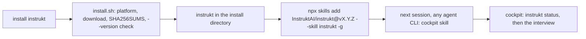
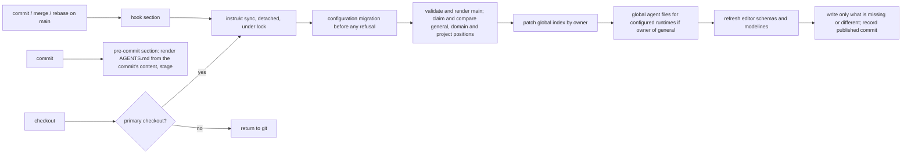
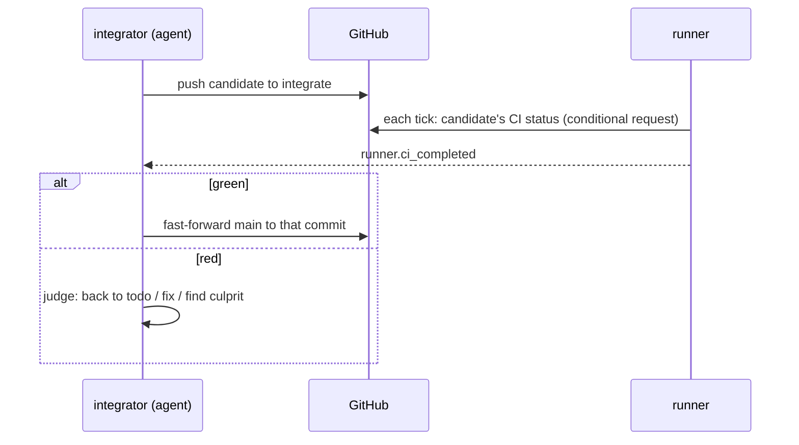
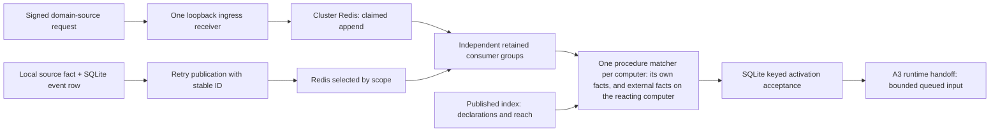
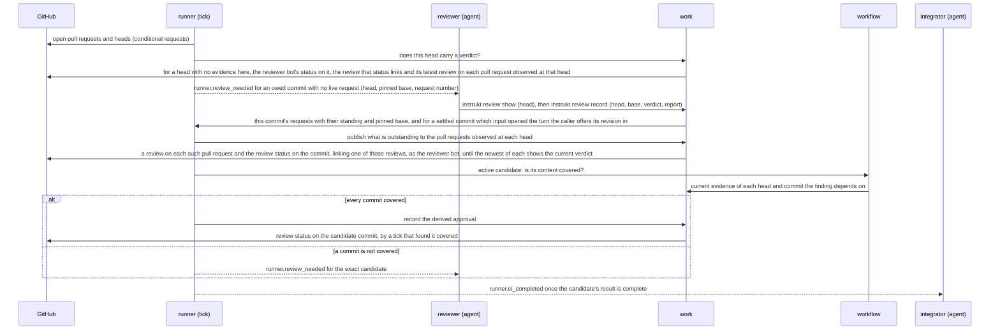

# Architecture Overview — Design

## Purpose

instrukt is a context-engineering module: a single
CLI that makes documentation the way agents are instructed and, when switched
on, runs the work those docs describe. It has no consumer daemon beside its runner; with a company's connector declared, an owned service keeps the runner running. Core operations are commands; enabled events also
have a narrow standalone loopback webhook receiver on the designated ingress.
Commands, independent event readers and the conversation-link stream reader
work against files, git, GitHub, scoped
Redis and the chosen runtime. Later work is triggered by git hooks, the OS
scheduler or retained events. Doctrine
comes from adopted docs repositories, not from instrukt.

The modules and their bounded contexts are listed in
`project/instrukt/spec/domain/context-map`; each context's model is its
domain spec. This design holds what spans them: the shape of the binary, the
home, and the flows.

## Inputs/Outputs

### Root separation

The inherited machine home supplies documented native defaults; explicit
INSTRUKT_HOME owns configuration, publication, state and secrets without copying
or falling back to normal machine secrets. Logs follow the separate native
INSTRUKT_LOG_DIR/shared logging contract. Scheduler artifacts use one runner-owned
SchedulerLocations value under the installation contract, never an artificial
application user directory. Native instruction variables are resolved by the
runtime adapter and consumed as facts by publication.


### Modules and crates

| Module | Contexts | Switch | Needs |
| --- | --- | --- | --- |
| `core` | docs, configuration, publication, repository, specs | always on | files, git |
| `blueprint` | blueprint | on/off | a graph engine adapter |
| `todos` | work, workflow; the runner dispatching todos | on/off; `runner.autostart` | GitHub, a runtime adapter |
| `history` | runner history extraction, retained search and merged queries | on by default | runtime conversation source for extraction; cluster Redis for merged search only, independently of events |
| `events` | runner sources, scoped transport, independent consumers and procedure activation | on/off | scoped Redis; selected runtime adapter for agent reactions; opt-in ingress for declared webhooks |
| `conversations` | company: connectors, conversation sessions and the answer back | a company home's declared connector | selected runtime adapter; the long-lived runner, kept running by an owned service |

One Cargo workspace, one binary `instrukt`. Crates: `instrukt-cli`,
`instrukt-core`, `instrukt-blueprint`, `instrukt-runner` (the runner context,
shared by `todos`, `events` and `history`), `instrukt-todos`,
`instrukt-company` (the company context's conversation core and connector
host), `instrukt-connector` (the connector interface and each kind's
declaration data) and one crate per connector, `instrukt-connector-slack`
first. Dependencies point one way:
`instrukt-cli` → the others; `instrukt-todos` → `instrukt-runner` →
`instrukt-core` and `instrukt-blueprint`; `instrukt-company` →
`instrukt-runner`, `instrukt-core` and `instrukt-connector`; a connector crate →
`instrukt-connector` only; `instrukt-blueprint` → `instrukt-core`;
`instrukt-core` → `instrukt-connector`, for the declarations configuration
validates against; `instrukt-connector` → nothing of instrukt. Only
`instrukt-cli` depends on `instrukt-company` or a connector crate. Where core needs an answer only an optional module has
(whether a todo slug named by a pending doc exists), core declares the
interface and the CLI wires the module's implementation in only when that
module is on. Eval is not a module: stamps always carry model, version and eval
fingerprint, and reporting is `instrukt eval report`, which builds an HTML report from the
record, together with the flavor's activatable report procedure that tells an
agent when and how to run it and what to say about it.

The runner declares interfaces for reading and mutating work items through
work’s command contract: recording and reflecting claims, flushing pending
reflection, recording last-fired stamps, setting automatic holds, purging expired
retained records, and reading and writing per-role session bindings. It also
declares an interface for reading workflow state. The todos crate implements
these contracts; the CLI wires them into the runner. Todo dispatch is realized
in the runner against those interfaces, preserving todos → runner → core.
The runner likewise declares conversation hosting in `instrukt run` and the
conversation assignment lookup; `instrukt-company` implements them (along with
explicit reply queueing for `instrukt company reply`) and the CLI wires them,
preserving company → runner → core.
Blueprint supplies its release-owned tool lifecycle to runner's module
installation; runner consumes that API rather than defining tool policy.
Core likewise declares the hook-generation interface; the CLI wires blueprint
into it when enabled. Core declares the todo-existence and flavor-role lookup
interfaces, wired by the CLI to todos only when enabled (`docs validate
--no-todo-lookup` leaves todo-existence unwired for service-free structural
checks, and work's todo-existence lookup reads local state without taking the
writer lock or creating state files).

Core declares a caller-identity lookup interface for configuration interpolation
and commit composition. The CLI wires the selected runtime adapter
into it; the lookup reads caller context without runtime I/O. Core never imports
runner. The CLI also wires owner-supplied work/standing assignment lookup into
command admission. The native caller identifies the recorded assignment whose
role, todo, home and workspace determine scoped grants; configuration supplies
class, bundles and model/App selection from the single `roles` map. The
code-owned catalog maps instrukt operations to actions and objects. Focused
roles are enforced, standing/agent roles use awareness help and briefing, and
all callers pass object checks under
`project/instrukt/spec/feature/configuration/roles-and-capabilities`.
Recognising a caller does not select a runtime. Missing known assignment
provenance is not a roleless bypass. A bot-role commit resolves its author from
the verified App actor even without native provider-agent identity; other
unverified agent identity remains unresolved.

The shared GitHub boundary uses configured project/author/reviewer Apps and
issues installation credentials from protected key references under
`project/instrukt/spec/feature/work/github-apps`. CLI wiring supplies its
credential and verified-actor interfaces to consumers without reversing crate
dependencies. Work checks record schema versions before dependent mutation and
converts supported older envelopes; repository composes the selected bot's
noreply author. Neither introduces person/company identity bands.

### The home

`~/.instrukt` is the normal machine home and is not a git repository. The
development wrapper for instrukt itself uses an isolated home per development
worktree; installed instrukt keeps shared machine state in ordinary project
worktrees under `project/instrukt/spec/feature/configuration/owned-files`.
Committed sources recreate publication. User-owned configuration and secrets, local
history and work-record writes not yet reflected to GitHub need preservation;
deleting the home is not a lossless reset.

| Path | Holds | Re-created from |
| --- | --- | --- |
| `instrukt.yaml` | the global configuration layer (runtime choice, App public profiles and fallback identity, non-bot git authors, module switches, runner settings) | the user |
| `agents.yaml` | the user's overrides of the shipped role map (class, scoped `can` bundles, model order/tier, App references) and provider-instance tier chains; optional | the user; the defaults are in the program (`project/instrukt/spec/feature/configuration/agent-selection`) |
| `secrets.env` | one owner-only machine-local source for all instrukt secrets, read by every path | protected secrets commands; model-provider keys remain with T3 |
| `companies/<name>/instrukt.yaml`, `companies/<name>/secrets.env` | a company home: the company's own settings document and its own owner-only secrets (`project/instrukt/spec/feature/configuration/company-homes`) | the user |
| `docs/general/`, `docs/<x>/`, `docs/project/<slug>/` | the published positions: snippets, `index.yaml` and `schema.yaml` when present, and a domain's `workflow/` flavor files | the owning project's committed main, by `sync` |
| `state/index.yaml` | the global index, every entry carrying its owning project, published-file location and source checkout provenance; project entries resolve to the committed project store | each project's `sync` |
| `state/publication/` | the ownership record (the one owner of each published position); per project, the commit last published and its checkout path; no record of the files a sync wrote outside the home | `sync` |
| `state/hook-runs/<repository>/` | each hook section's last run outcome for one repository, shared by all its worktrees: the folder is named by a digest of the repository's git common directory, and each record names the repository's path; shown by `instrukt hooks status` | the next hook run |
| `state/instrukt.db` | the state database (SQLite, WAL; `-wal` and `-shm` beside it): the local work record — todos and their status, artifacts and their reflection state, approvals, stamps, session bindings, pending and confirmed GitHub revisions, last known copies of the todos held elsewhere — and the runner's state — the event log with consumer cursors and handled marks, conditional-request validators, watched-ref observations, dispatched executions, authoritative object bindings and generation history, pending delivery targets and per-key locks, conversation links and directional relay positions, held task failures and the last wake-up; schema in `project/instrukt/spec/feature/work/state-database` | the work record from GitHub by pull-through (unreflected writes are lost); operational runner state, authoritative object bindings and generation history must be preserved |
| `state/writer.lock` | the per-computer writer lock (the database's write-isolation unit), held for each local state-database write transaction, including migration before an older-state read, and, while earlier history is moved out of the database, in one hold across the removal of the copied tables and the reclamation of their space, which is not a transaction and lasts as long as the freed space and the remaining data need; current-schema readers, network waits and reactions run outside it | taken again by the next writer |
| `state/reflection.lock` | the per-computer lock serializing GitHub reflection across requests; it briefly takes the writer lock for each local commit of what reflection learned, always in reflection → writer order; local writers release the writer lock before acquiring it and current-schema local readers take neither lock; older-state readers first take the locked migration path | taken again by the next reflection |
| `state/withdrawal.lock` | the per-computer lock a withdrawal command holds from before it records or resumes its intent (`withdrawal_intents`) until it closes it or returns, across its git and filesystem release and outside the writer lock, so a recorded intent no command holds is told apart from one in progress; an intent a refusal keeps stays recorded after the command releases the lock; taken before the writer lock and released before the withdrawal's reflection | taken again by the next withdrawal |
| `state/history.db` | the history store (SQLite, WAL; `-wal` and `-shm` beside it): retained conversations with their documents, their messages and the full-text index over titles and message text, each source's extraction position and each TeleClaude import's progress; schema in `project/instrukt/spec/feature/runner/history` | must be preserved: only conversations still held by a source can be extracted again |
| `state/history.lock` | the history store's write-isolation unit, held for each history write — a catch-up section, one import batch, bringing a store of an earlier schema version forward and reclaiming the space that freed, which a reader that finds such a store does before it reads, or moving earlier history out of the state database. Once that move is recorded complete no history read or write takes the writer lock; the move alone takes it, to bring the state database to its current schema or create it and to remove the copied tables and reclaim their space | taken again by the next history write |
| `state/runner.lock` | the lock serializing runner invocations | taken again by the next runner |
| `state/runtime-dispatch.lock` | serializes runtime dispatch owners for one command or wake; released between long-lived runner wakes so agent-issued commands remain available | taken again by the next runtime invocation |
| `state/eval-fingerprint/` | per published commit, the digest of all published `eval: true` snippets | `sync` |
| `state/blueprint/<project>/<sha>/` | the latest complete graph and the one before it, per remote-main revision | the next push or pull |
| `git/<host>/<owner>/<repo>/` | ingested external repositories with their `index.md` and `history.md` | a fresh clone |
| `state/machine-id` | this computer's id, created once; the holder of its claims | re-created on first use (deleting it orphans this computer's live claims until they are released) |

The state directory is resolved to its canonical location once, and every path and
lock above derives from it, so a home reached through a link keeps one authority;
a link at the database file itself is refused
(`project/instrukt/spec/feature/work/state-database`). The state database also holds
the read-back cursor of each connector (`connector_read_back`), each conversation
message's no-work interval and the current state of the runner's background
workers — the history workers and the readiness refresh (`runner_workers`). Installation keeps no record of the units it wrote and the runner
service publishes no identity: both converge by name
(`project/instrukt/spec/feature/runner/module-installation`).

A project carries `instrukt.yaml` (the project layer) and documentation in
three positions:

```
docs/general/       always on: rendered into every agent CLI's user-scope instruction file   ids general/<type>/…
docs/domain/<x>/    on demand: one line in the global file; rendered by `instrukt docs get --domain <x>`   ids <x>/<type>/…
docs/project/       the project: rendered into its root AGENTS.md   ids project/<slug>/<type>/…
```

Holding `docs/general/` or a `docs/domain/<x>/` is what makes a project
publish it; one project owns each on a computer, and `general`, `project` and
`third-party` (whose published tree is unchanged) are never a domain's name. Each position may carry an `index.yaml` selecting
what is rendered and a `schema.yaml` adding sections
(`project/instrukt/spec/domain/docs`). The project also carries its one
committed `AGENTS.md`, at its root, rendered at each commit from
`docs/project/index.yaml` and the repository's own content, the generated and
git-ignored `.instrukt/schemas/` its YAML files' modelines name, and
instrukt's marked sections in its git hooks. No generated index lives in a
repository, and no git filter rewrites its files: references are snippet ids
the CLI resolves when read.

### Common CLI surface

Every public command accepts `-h` and prints its own command and flag
contract without executing its operation: what the command, each flag and
each setting it touches is for, and when to choose it. `instrukt -h` lists the
commands. Docs name `-h`.

A command that fails ends with one readable line on stderr, `instrukt: `
and then what failed, where, and what to run when there is a door; it is
printed once and the exit status is non-zero. An error's causes follow it
on that line, each once; findings that read as a list are joined with `; `.
A command that meant to act and could not — a writing `docs render` left
with findings, a converging `install` left incomplete, `docs get` with a
configured value it could not resolve, `docs schema` with findings, a
`history search` that could not reach every computer — ends the same way,
after its output, exit status 1; its line points at what that output holds
in the mode it was asked for, text or JSON.

A command whose job is to report findings keeps its report as its output
and adds no line: its exit status says there are findings. `config
validate`, `docs validate`, `docs render --check`, `install --check` and
`specs coverage --check` exit 1 with findings; `status` exits 0 whatever its
report says once every part was read, and 1 when a part could not be read
(`project/instrukt/spec/feature/publication/instrukt-status`); `specs reserve`
exits 3, 4 or 5 for a reserved, unknown or ambiguous use case; `todo work`
exits 1 when the todo cannot be claimed or its factual ledger cannot be
rendered, and its output says why.
Nothing on the terminal is a program's debug rendering of a value: durations
are whole seconds, kinds and verdicts their plain names. Usage errors keep
the command-line parser's own text and exit status 2.

### External surfaces

| Surface | Used by | How |
| --- | --- | --- |
| git | publication, repository, blueprint, workflow, runner | the `git` CLI; hooks |
| GitHub | work, workflow, runner | its API (address configurable, `github.api_url`) through one writer per computer |
| Configured agent runtimes | publication | rendered global files in each configured runtime's home, written whole on every sync and never removed, and the entrypoint-loading settings each requires; the configured runtimes are read through the selected runtime's adapter |
| Configured runtime | runner | Rust adapter trait; compiled `t3` implementation over host `t3 thread start`, `send`, `list`, `show`, plus read-only durable T3 projection-database reads with native change notifications; `runner.runtime`, unset meaning the compiled adapter, never detected; unattended operations only, native agent operations rendered from runtime instruction configuration |
| Configured graph engine | blueprint | an adapter emitting the node-link contract |
| Declared MCP servers | runner | `instrukt mcp`: a connection per call over the network, carrying the login `project/instrukt/spec/feature/runner/mcp-access` selects |
| OS scheduler | runner | `instrukt tick` each minute |
| OS service manager | runner | the ingress receiver's socket and service, and with a company's connector declared the owned service that keeps `instrukt run` running (`project/instrukt/spec/feature/runner/module-installation`) |
| Slack | company, through its Slack connector | one Socket Mode connection opened outward per declared Slack connector (`connectors.<name>` with `kind: slack`, or `connectors.slack`), hosted in `instrukt run` by the runner with `(company, connector)`-isolated bot identity and rate limits; its history and posting calls with the bot token (`project/instrukt/spec/feature/company/slack-connector`) |
| GitHub Releases | distribution | per tag: an archive per target, `SHA256SUMS` and `install.sh` |
| Agent Skills and the `skills` command (`skills.sh`) | distribution | the cockpit skill `skills/instrukt/SKILL.md`, installed into every agent CLI on the computer |

## Invariants

- **Explicit execution lifetimes.** `run` hosts long-lived independent readers;
  scheduled `tick` drains pending then new instrukt-event entries within a
  bounded invocation. Conversation links have a native-thread stream reader
  in `run`, with ordinary restart from durable per-link positions.
  The separately installed ingress receiver outlives runner downtime. There is
  no additional consumer daemon; scheduled-only reactions wait for the next wake.
- **Each project publishes only its own part.** Publication never reads
  another project's repository; the global index is patched by owner, never
  rebuilt from all sources. `docs get` reads project snippets from
  `~/.instrukt/docs/project/<slug>/…`, including another project's ids;
  source paths identify where to author, not where to read live content.
- **Committed state is the source.** Publication reads a project's committed
  main, never its working tree; the blueprint is generated for a pushed
  revision.
- **The record is the state.** The workflow engine stores no phase; it derives
  state from the record on every call.
- **Main is green by construction.** Only the integrator moves main, and only
  to a commit whose checks passed.
- **Git hooks belong to everyone.** instrukt touches only its marked section,
  never uses `exec`, and never blocks git after the fact.
- **A cloned repository does not decide what runs on a machine.** The runtime
  choice lives only in the global layer, and so does the command form of
  `blueprint.engine`; a project layer may only name a shipped adapter.
- **Owned child commands leave no descendants.** instrukt cleans each own
  child-command process group on success, failure, timeout and interruption;
  the runtime retains ownership of its agent lifecycle.
- **Agents read; instrukt computes.** Freshness, ownership and state are
  instrukt's to compute; agents consume answers that name what they reflect
  (a SHA, a version).

## Primary flows

### Install



The release installer is the one way the binary is installed or upgraded,
from any agent or none: it writes only `instrukt` into the install directory
(`$INSTRUKT_INSTALL_DIR`, else `$XDG_BIN_HOME`, else `~/.local/bin`) and
touches no profile, home or agent setting. The skill carries no binary and
upgrades none on its own; a skill and a binary of the same release share one
version. Everything set up afterwards goes through the CLI into the
configuration layers, never into the skill
(`project/instrukt/spec/domain/distribution`).

### Publish



### Read

`instrukt docs index` shows everything published plus the `docs/project/` docs
of the project the caller stands in, and `--domain <x>` narrows it to one
domain; `instrukt docs get <id>` reads a snippet naming its required reads,
`--closure` adds them transitively, each once, and `--domain <x>` renders that
domain's `index.yaml`. Every reference is a snippet id (or a bare domain name in
a required read) that the CLI resolves; `get` resolves `@config` directives
in-process at read time for configured values. Agent operations render native
instructions from the selected runtime entry; the agent carries them out in its
own conversation. The compiled adapter acts for instrukt without an agent, or
for an explicitly missing native capability. No snippet runs a command. Authoring reads and edits the source file;
`docs get` is for knowledge.

### Push and map

A graph exists for every remote-main revision a machine gets: the pre-push
section sees its own push to `main`, and a pull that moves main (post-merge,
post-rewrite) brings another; each records the SHA and starts generation
detached, so git never waits. How generations are serialized, stored and chosen is the blueprint context's
(`project/instrukt/spec/domain/blueprint`); answers always name the SHA
they reflect.

### Integrate



Branch protection with required checks refuses any push of main to a commit
without a green result. A project without CI gets the same gate locally: the
integrator runs the project's documented test command on the candidate, and only a
passing candidate is fast-forwarded onto main.

### Run

The runner (`instrukt run`, or `instrukt tick` from the OS scheduler) does what
the switched-on modules need: it dispatches todos (when `runner.autostart`), and
starts or wakes standing agents on events. It reaches a runtime only through its
Rust adapter for unattended operations. Its operational sessions surface is
`instrukt sessions list`; agents discover and operate conversations
through configured native instructions, recording attempts and native child ids
through work commands. Start-or-wake holds exact object-key ownership across
native operations and short database transactions. The binding is authoritative:
each generation captures its native command/thread IDs and launch request before
creation. Lost replies replay that fixed native identity; unknown observations
and sends leave work pending. Outstanding work after confirmed native archive or
deletion starts a successor generation through the same owner.
instrukt derives the single repository todo branch `<slug>/work`; T3 creates the
corresponding worktree from `origin/main` (or from an un-integrated legacy
prepare branch during upgrade) and refuses an existing local `<slug>/work`
branch. Work on another computer creates its local `<slug>/work` branch from
`origin/<slug>/work`. Native shared children (both preparation and build roles)
use that recorded workspace serially and commit directly on `<slug>/work`;
completion stamps release attempts atomically. `kind: task` creates no git
worktree. Pending docs fold at work delivery, and after confirmed delivery
the integrator removes the clean `<slug>/work` worktree and deletes `<slug>/work`
locally and on origin. Ad hoc work uses its own reviewed one-off worktree; main
is integrator-only.
Before dispatch each tick, the runner fetches canonical remote main and
fast-forwards a clean canonical checkout when it lags. Post-merge publication
and blueprint maintenance run on each computer; dirty or diverged checkouts
are reported and preserved. No integrator-owned local sync or main-ahead event
is needed. New phase branches use freshly fetched origin/main.
Session ending remains the runtime's responsibility. A step is done when the
record carries its artifact and stamp, never when a session's reply says so.
Whatever needs the human is a session asking in its thread; only anomalies are
sent through `runner.notify`.

<!-- planned-change:standing-sdlc-coordinator -->
Procedure activation is durably accepted before runtime execution. The adapter
supplies procedure-first assignment and untrusted event data through bounded
logs with one session-wide waiting slot. T3 realizes ASAP through queued input;
only-at-entry delivery waits for observed idleness. Standing T3 threads remain
unsettled under automation; a human-settled thread stays reachable and wakes
on its next message.
<!-- change:standing-sdlc-coordinator -->
Procedure activation is durably accepted before runtime execution. The adapter
supplies procedure-first assignment and untrusted event data through bounded
logs with one session-wide waiting slot. T3 realizes ASAP through queued input;
only-at-entry delivery waits for observed idleness. Automation never settles a
standing T3 thread. A standing agent whose procedure names a rest condition
settles its own thread there through the configured settling action
(`project/instrukt/spec/feature/runner/procedure-standing-agent`); a settled
standing thread, by rest or by a human, stays reachable and wakes on its next
activation or message.

Fleet attention composes three owners without a watcher. Work calls the
runner's fleet-attention contract with the facts of each change it makes to a
todo's status, hold or attempts, inside that change's own transaction; the
runner decides which facts are conditions and appends them, together with the
conditions it observes in executions and an agent's raise through
`instrukt events raise`. The project's subscribed coordinator answers them, and
the end of an attention episode wakes it once so it can rest
(`project/instrukt/spec/feature/runner/fleet-attention`).
<!-- /planned-change:standing-sdlc-coordinator -->

### Conversation links

The runner's conversation aggregate and identity-envelope vocabulary live in
`project/instrukt/spec/feature/runner/conversation-links`, indexed by its domain
spec. General reading discipline is `general/policy/message-identity-headers`.
The runtime adapter supplies read-only native conversation changes and target input; work owns
only the existing state database's file, migrations and writer boundary. No
additional bounded context or process is introduced.

An independent reader in long-lived `instrukt run` follows each linked T3
thread through the adapter's read-only conversation source, with per-conversation
fingerprints and native database change notifications. The reader uses no T3
session token and owns per-link positions independently of history. Runner
admission and delivery use
recorded assignments and native identities. Native turn completion releases
recorded conversational content to the peer in identity envelopes. Link and
per-direction progress commit in the existing database, outside native network
waits; ordinary startup resumes retained positions. Relay failure is visible in
`instrukt events status` and logs. This reader has no scheduled tick path. Besides
native notifications it reads again when the source asks its readers to
(`project/instrukt/spec/feature/runner/history`).
Redis remains transport only.

### Event platform



Ingress addresses `/hooks/inbound/project/<slug>/<domain>` and
`/hooks/inbound/company/<name>/<domain>`. The declaring home's
`webhooks.<domain>` declaration selects secret references, verification
(native, GitHub or generic HMAC-SHA256) and exactly one event-name source:
native `{name, payload}`, `name_from`, fixed `name` or GitHub normalization.
The event type is `<domain>.<name>` and its subject identifies that domain and
home; `inbound_verify` retains protocol provenance. Undeclared domains have
no endpoint. Person intake remains unavailable.

Local commit and stream acceptance are separate. Existing event rows supply a
retryable publication handover; ingress accepts only after cluster append or a
recognized source-scoped duplicate. Redis groups own transport positions and
bounded replay. SQLite retains local settled accounting, seven-day occurrence
marks and keyed activations. Consumer outcomes commit before Redis ACK; neither
is a business-effect completion. Ordered retries park persistently failing events
with evidence and announcement before ACK, independently of other consumers.

Subscription validation belongs to docs, registration/index replacement to
publication, selection and acceptance to runner. A computer's own events
activate only where they are emitted; external facts activate only on the
reacting computer, the ingress unless `ingress.reactions` names another, and
unavailable homes fail there.
Runtime delivery retains procedure-first briefing, untrusted event provenance and
session-fixed timing through A3's bounded batch log.

### Review gate

On a project that opts in, every commit GitHub checks before the canonical
branch advances carries the reviewer bot's review status, obtained without
anyone asking: an eligible pull request's current head and the integrator's
candidate. Four contexts take part and each keeps its own decision; the review
itself belongs to the procedure that answers the request.

| Context | Decides | Contract |
| --- | --- | --- |
| runner | Which commits are owed a review; the one live request per commit and its repetition until a verdict exists | `project/instrukt/spec/feature/runner/pull-request-review` |
| work | Review evidence and its admission, which evidence is current, its publication and transfer, and the two identities' readiness | `project/instrukt/spec/feature/work/github-apps` |
| workflow | Whether a candidate's content is covered | `project/instrukt/spec/feature/workflow/integration-gate` |
| configuration | The per-project opt-in and where its prerequisites are refused | `project/instrukt/spec/feature/configuration/layered-configuration` |



A review is one judgment of one commit from the pinned base its request
carries, which the runner selects
(`project/instrukt/spec/feature/runner/pull-request-review`, Review requests).
A verdict covers the canonical branch only when that base lies on it, and
earns candidate coverage only then. Requests are counted per commit: one is live
at a time, and a request delivery selected for handover keeps the commit until
its outcome is known, whichever pull requests point at it meanwhile. The
outcome is delivered to every eligible pull request at that commit. The runner
reads GitHub and decides what is owed; it decides nothing about a verdict.
Work admits the first verdict for a commit; only the settling session revises
it, in a turn no request for the commit opened. Where a request of the commit
reached that session, work asks the runner which input opened the turn the
session has in progress; while the runtime cannot say, the revision is refused
within the command's wait, and the earlier version stays current and
published. A candidate's result follows work's current verdict of it before
the status does: needs work is a failed result from its admission. A derived
approval is
derived again until GitHub shows it as the status, and is withdrawn when a
commit is no longer covered
(`project/instrukt/spec/feature/workflow/integration-gate`).

instrukt owns the review state and GitHub reflects and enforces it. Evidence
is recorded locally before anything is published, and GitHub receives two
publications and no evidence: the review status and the pull-request reviews.
Each follows the commit's current verdict by what the reviewer bot published
last, so a revision replaces what an earlier version left there, also when it
returns to an earlier outcome, and a publication is retried from the evidence
without another review (`sdlc/policy/state-storage`). The status links the
review that carries the same verdict, so the review of a commit is found from
the commit itself.

Review state has three stores, split by who writes and who waits. Commands
wait on the evidence store alone; the tick writes the other two, and none of
them takes the state database's writer lock.

| Path | Holds | Re-created from |
| --- | --- | --- |
| `state/review.db` | head verdicts with their versions, reports and moments, each standing here, handed off by an export or set aside by an import, exemptions and imported derived approvals; written only by the `instrukt review` commands | nothing: it is the only copy of this computer's evidence and must be preserved; another computer receives it through an export |
| `state/review.lock` | the evidence store's write-isolation unit, held for each of those commands' transactions | taken again by the next command |
| `state/review-publication.db` | the derived approvals the tick recorded and each withdrawal of one, what GitHub shows of each current verdict per destination, and the verdicts recognised as already published with their review body; written only by the tick | what GitHub shows, and a fresh coverage derivation for the integration head; the derived approval of a candidate the canonical branch has taken and each withdrawal with the commit found uncovered are not re-created |
| `state/review-publication.lock` | the publication store's write-isolation unit, held for each tick's publication writes | taken again by the next tick |
| `state/review-observation.db` | the pages of the pull-request listing with their conditional validators; written only by the tick's review observation | one unconditional request per page |
| `state/review-observation.lock` | the observation store's write-isolation unit, held for each observation pass's writes | taken again by the next pass |

One computer serves a project's automatic review: the one the project is
admitted on. It alone observes and publishes. Serving moves to another
computer with the evidence that stands in the evidence store, through
`instrukt review export` on the one and `instrukt review import` on the other.
An export is one snapshot under the evidence lock, declared by its digest. It
hands the exported verdicts off: the exporting computer publishes and revises
them no further, and they stand again where the file is imported. An import
adds to what the importing computer holds; where another verdict of a commit
stands there, it changes nothing until its operator states which stands, and
the other one is kept as set aside. A computer that
serves without an import recognises, among the verdicts the reviewer bot
published for a head, the one decided last, from its status, the review that
status links and its reviews on the pull requests observed there. Every
publication carries the moment its verdict was decided, and that moment orders
them; the date GitHub gives a publication says when it was delivered, and a
verdict repeated on a further pull request keeps the moment it had. A verdict
that an import keeps or makes current over another one is given a moment
later than that one's where it is not later already, so the operator's choice
orders two verdicts as a revision orders two versions. The
computer brings a status or a pull request that lags behind that verdict up to
it and asks for the rest.
Observation rides the tick's existing
conditional GitHub pass, requests the event platform and publication the tick;
the gate adds no webhook, queue or process.

## Failure modes

- **The program panics:** the terminal shows only `instrukt stopped
  unexpectedly; the details are in <log path>`; the panic's message and
  location go to that log, and the exit status is 101. A panic before the
  command's log is open names the log folder and records nothing.

- **A hook did not fire** (a reset): the next `sync` from any trigger catches
  up, because every sync converges on main; `docs get` warns when
  publication is behind main, and `instrukt sync` republishes on demand.
- **Committed docs fail validation:** `sync` publishes nothing for that commit;
  the previous publication stays, and `instrukt hooks status` shows the
  refusal.
- **Two projects claim one domain, or `docs/general/`:** the second `sync` is
  refused and names the owner; the published tree is unchanged.
- **The selected runtime cannot be asked:** the `general` owner's `sync`
  writes no global agent file, publishes the rest and names the runtime and
  the cause; the next sync of that project writes them.
- **A hook manager regenerated a hook file** and dropped instrukt's section:
  `instrukt hooks status` reports it and prints the line to add to that tool.
- **Graph generation fails or is interrupted:** the previous complete graph
  stays; answers keep naming its SHA.
- **GitHub unreachable:** work continues against the local record; reflection
  resumes when GitHub is reachable.
- **Main turns red anyway:** the integrator reverts the culprit first and
  repairs it in its own todo.
- **`runner.runtime` names no compiled adapter:** runtime-dependent module
  enablement refuses and names it. Unset, it is the compiled adapter; code never
  detects one. A missing caller context makes
  `runtime.session_id` fail and omits a commit's `Session:` trailer.
- **Runtime identity or delivery is uncertain:** preserve the event and captured native launch request/IDs; recover through
  native fixed-key receipt replay. A failed
  observation or send never requests a replacement session.
- **Conversation stream or relay fails:** the runner retains its link, position
  and pending handover evidence and exposes the failure through
  `instrukt events status` and logs under the conversation-link contract.
- **A deleted orchestrator left its todo branch checked out:** native keyed launch
  attaches the verified retained worktree to the new object generation. A
  settled retained orchestrator wakes in its existing shared workspace.
- **Document validation runs in an isolated or unprovisioned home with `modules.todos` on:**
  an isolated temporary `INSTRUKT_HOME` or CI runner holds neither a work state
  database nor `github.project_app`, so live todo-slug existence lookup cannot
  resolve pending markers and fails explicitly with the GitHub App repair door
  while leaving the home unwritten. Service-free checks and CI run
  `instrukt docs validate --no-todo-lookup` to omit the live existence lookup
  while keeping slug-form, pending-marker, workflow-role and all other
  structural checks (`project/instrukt/spec/feature/docs/snippet-validation`).
- **Concurrent reflection is slow or busy:** `state/reflection.lock` serializes
  GitHub reflection across commands and ticks without holding `state/writer.lock`;
  local state-database reads and writes proceed immediately, and a command whose
  reflection wait times out keeps its committed local write as pending reflection
  for the next flush.
- **A reflection is interrupted after GitHub accepted its revision:** this
  computer recognises the landed revision afterwards only while its local
  record still equals it. Otherwise the todo is marked conflicted, and
  `instrukt todo refresh <slug>` is its door
  (`project/instrukt/spec/feature/work/github-record`).
- **A runtime provider's dynamic option descriptor or effort vocabulary diverges from instrukt's offline per-kind mapping:** offline configuration validation (`project/instrukt/spec/feature/configuration/agent-selection`) and pure adapter effort translation (`project/instrukt/spec/feature/runner/session-continuity`) do not query live provider option descriptors. When an ACP or SDK provider advertises a different option identifier or a wider effort set than the static per-kind mapping carries, native delegation receives an invalid-request option rejection or configuration rejects the effort value until the per-kind mapping is updated; provider-free T3 contract checks (`project/instrukt/spec/feature/runner/t3-contract`) do not exercise live provider option descriptors.
- **A turn's commit becomes readable after the read its notification triggered:**
  that read finds nothing new and ends successfully, no native notification
  follows, and the link shows neither a failure nor a pending handover for the
  turn. Each reader then reaches the turn on its own trigger. Link relay reads
  again when the source asks its readers to
  (`project/instrukt/spec/feature/runner/conversation-links`). History
  extraction reads again on the requests it follows
  (`project/instrukt/spec/feature/runner/history`). A company conversation
  with outstanding work reads again on the company relay's own retry
  (`project/instrukt/spec/feature/company/conversations`). A history search or
  an explicit extraction catches up history only.

- **A reviewer's turn ends without a verdict for a head it was handed:** the
  head stays owed. While it is still current the runner asks again at growing
  intervals; the head carries no review status meanwhile and, where the status
  is required, cannot merge.
- **A review request is accepted by the runtime and never seen entering a
  turn:** the request ends as unconfirmed and the commit is asked for again.
  If the first handover enters after the commit was settled, its procedure
  reads the commit's evidence first and reviews nothing.
- **A request selected for handover belongs to a commit that stopped being
  owed:** it is handed over as selected and stays live; no other request is
  emitted for that commit until its outcome is known.
- **A commit stops being a head while its request is live and becomes one
  again, on the same or another pull request:** no second request is emitted;
  the live review is that commit's and its verdict reaches the pull requests
  then at that head.
- **A head is replaced before its request reaches a reviewer and later becomes
  current again:** it is asked for under a new request; the replaced request's
  record does not stand in its way.
- **GitHub is unavailable while a verdict waits for publication:** the
  evidence stays recorded with its publication outstanding and its cause; a
  later tick publishes it. The review is not repeated.
- **GitHub shows an earlier version of a commit's verdict, or lost its
  status:** the status and the reviews are written again from the current
  verdict; a reversed verdict replaces the earlier one, and a verdict that
  returns to an earlier outcome is written as a new review.
- **A pull request is closed before its review was written and reopened at the
  same head:** the review is owed again and written from the existing
  evidence.
- **A session records a verdict while a request of that commit is selected and
  no session holds it yet:** the verdict is refused; the review is that
  request's.
- **The runtime cannot say which input opened the turn of a settling session
  that a request of the commit reached:** the command asks again within its
  own wait and then refuses the revision, naming the runtime. Nothing is
  recorded, the earlier version stays current and published, and the session
  records the revision once the runtime answers.
- **A needs-work version of a candidate's verdict is admitted while GitHub
  still shows the earlier approving status:** the candidate's result is a
  failure from that tick on, whatever the status shows, and the failure status
  follows when it is published.
- **A covering head's approval is replaced by needs work before the
  candidate's derived approval reached GitHub:** the derivation that precedes
  publication finds the commit uncovered, the derived approval is withdrawn
  and the exact candidate is reviewed. A derived approval reaches GitHub
  status first, so nothing of a withdrawn one was published.
- **A candidate adds a commit that is neither an approved head, reproducible
  nor exempted by its author:** it receives no derived approval; the exact
  candidate is reviewed, and promotion waits for that verdict.
- **A recovery candidate removes more than the red head's own promotion
  added:** it is not covered as a revert; the exact candidate is reviewed.
- **A verdict is recorded while its project's evidence is being exported:**
  the recording falls wholly before the snapshot or wholly after it; a later
  version of a handed-off verdict is refused on the exporting computer and
  names the export and its door.
- **An import brings another verdict of a commit than the one that stands
  here:** the import is refused whole and names the commit; nothing changes
  until the operator states which verdict stands, and the other one is kept
  as set aside.
- **An export file is imported again:** with the same statement it changes
  nothing further. A file whose content does not match the digest it declares
  is refused whole.
- **An export file is lost before it is imported:** its verdicts stay handed
  off on the computer that wrote it and stand nowhere. The computer that
  serves next recognises what was published of them and has every other owed
  head reviewed again.
- **An earlier file is imported on a computer that has since handed the
  commit's verdict on:** the file's version stands there again. Work keeps no
  account of where a verdict went; the two are met as two verdicts of one
  commit when a file of one computer reaches the other, and the operator
  states which stands.
- **A head with no evidence here already carries the reviewer bot's status,
  and another eligible pull request has it as its head:** the review that
  status links is read, also from a pull request that was closed unmerged, and
  written to that pull request too; no review is asked for. A status that no
  review accompanies is recognised as well: no review is asked for and none is
  written.
- **A publication stopped between a review and its status, and a computer
  without the evidence serves next:** the verdict decided last among those the
  reviewer bot published is recognised from the reviews on the observed pull
  requests as well as from the status, the status is brought up to it, and a
  verdict decided earlier is never written over a later one.
- **A computer without the evidence repeated an approval on a further pull
  request while the pull request carrying a later change request was a draft,
  and that pull request is ready again:** the repeated approval carries the
  moment of the approval it repeats, so the change request is the verdict
  decided last although GitHub received it earlier. The status and the other
  pull request are brought up to the change request with its findings, and the
  head is not reviewed again.
- **An import chose a change request over a verdict whose approval was
  recorded later and is on GitHub, the publication stopped between the review
  and the status, and a computer without the evidence serves next:** the
  import gave the chosen change request a moment later than the approval's, so
  the review on the pull request is the verdict decided last although its
  review was judged first. The status is brought up to it, the approval that
  was set aside is written nowhere again, and the head is not reviewed again.
- **The publication store is lost after a tick withdrew a derived approval:**
  the account of that withdrawal and of the commit found uncovered is gone and
  no derivation gives it again. Nothing is published from the loss: an approval
  GitHub does not show is derived again before anything of it is written.
- **A computer is lost, or loses its home, without an export:** what it had
  not published is gone. The computer that serves next recognises what the
  reviewer bot published, has every other owed head reviewed again, and shows
  whatever approval GitHub last received.
