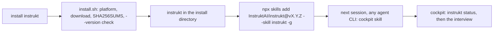
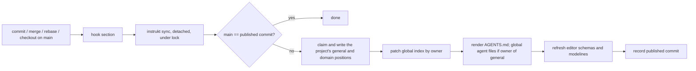
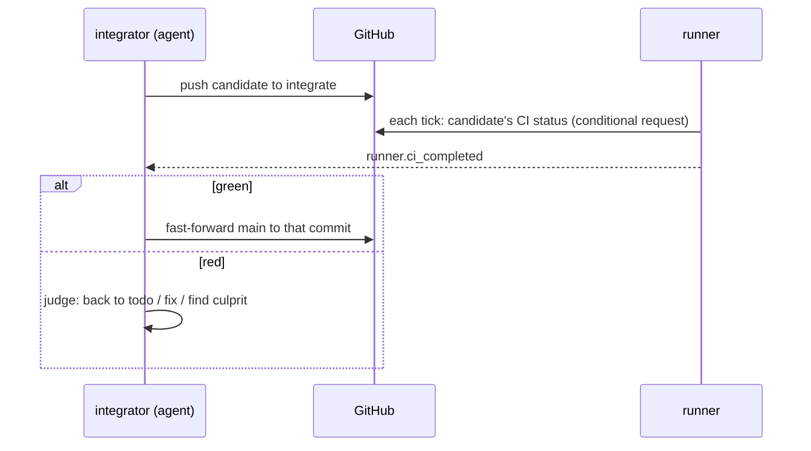
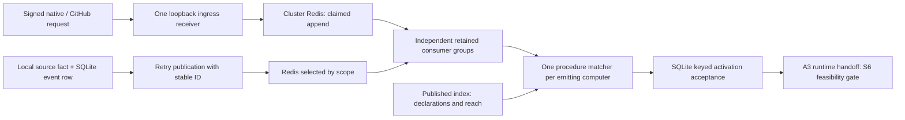

# Architecture Overview — Design

## Purpose

instrukt is a context-engineering module: a single
CLI that makes documentation the way agents are instructed and, when switched
on, runs the work those docs describe. It has no consumer daemon. Core operations are commands; enabled events also
have a narrow standalone loopback webhook receiver on the designated ingress.
Commands and independent event readers work against files, git, GitHub, scoped
Redis and the chosen runtime. Later work is triggered by git hooks, the OS
scheduler or retained events. Doctrine
comes from adopted docs repositories, not from instrukt.

The modules and their bounded contexts are listed in
`project/instrukt/spec/domain/context-map`; each context's model is its
domain spec. This design holds what spans them: the shape of the binary, the
home, and the flows.

## Inputs/Outputs

### Modules and crates

| Module | Contexts | Switch | Needs |
| --- | --- | --- | --- |
| `core` | docs, configuration, publication, repository, specs | always on | files, git |
| `blueprint` | blueprint | on/off | a graph engine adapter |
| `todos` | work, workflow; the runner dispatching todos | on/off; `runner.autostart` | GitHub, a runtime adapter |
| `events` | runner sources, scoped transport, independent consumers and procedure activation | on/off | scoped Redis; selected runtime adapter for agent reactions; opt-in ingress for declared webhooks |

One Cargo workspace, one binary `instrukt`. Crates: `instrukt-cli`,
`instrukt-core`, `instrukt-blueprint`, `instrukt-runner` (the runner context,
shared by `todos` and `events`), `instrukt-todos`. Dependencies point one way:
`instrukt-cli` → the others; `instrukt-todos` → `instrukt-runner` →
`instrukt-core`; `instrukt-blueprint` → `instrukt-core`; `instrukt-core` →
nothing of instrukt. Where core needs an answer only an optional module has
(whether a todo slug named by a pending doc exists), core declares the
interface and the CLI wires the module's implementation in only when that
module is on. Eval is not a module: stamps always carry model, version and eval
fingerprint, and reporting is `instrukt eval report`, which builds an HTML report from the
record, together with the flavor's activatable report procedure that tells an
agent when and how to run it and what to say about it.

The runner declares interfaces for reading and mutating work items through
work’s command contract: recording and reflecting claims, flushing pending
reflection, recording last-fired stamps, setting automatic holds, purging expired
retained records, and reading and writing per-role session bindings. It also
declares an interface for reading workflow state. The todos crate implements
these contracts; the CLI wires them into the runner. Todo dispatch is realized
in the runner against those interfaces, preserving todos → runner → core.
Core likewise declares the hook-generation interface; the CLI wires blueprint
into it when enabled. Core declares the todo-existence and flavor-role lookup
interfaces, wired by the CLI to todos only when enabled.

Core declares a caller-identity lookup interface for configuration interpolation
and commit composition. The CLI wires the explicitly selected runtime adapter
into it; the lookup reads caller context without runtime I/O. Core never imports
runner. Missing context or unverified agent identity stays unresolved;
recognising a caller does not select a runtime.

### The home

`~/.instrukt` is fixed and is not a git repository. Everything in it is
re-creatable, except local work-record writes not yet reflected to GitHub,
which are lost if the home is deleted.

| Path | Holds | Re-created from |
| --- | --- | --- |
| `instrukt.yaml` | the global configuration layer (runtime choice, agents' git authors, module switches, runner settings) | the user |
| `docs/general/`, `docs/<x>/` | the published positions: snippets, `index.yaml` and `schema.yaml` when present, and a domain's `workflow/` flavor files | the owning project's committed main, by `sync` |
| `state/index.yaml` | the global index, every entry carrying its owning project; `docs/project/` entries carry the absolute path of the file in their project | each project's `sync` |
| `state/publication/` | the ownership record (the one owner of each published position); per project, the commit last published and its checkout path; the written record of each user-scope instruction file instrukt wrote | `sync` |
| `state/hooks/<project>/` | each hook section's last run outcome, shown by `instrukt hooks status` | the next hook run |
| `state/instrukt.db` | the state database (SQLite, WAL; `-wal` and `-shm` beside it): the local work record — todos and their status, artifacts and their reflection state, approvals, stamps, session bindings, pending and confirmed GitHub revisions, last known copies of the todos held elsewhere — and the runner's state — the event log with consumer cursors and handled marks, conditional-request validators, watched-ref observations, dispatched executions, standing-agent binding caches, pending delivery targets, start markers and per-key locks, held task failures, the last wake-up; schema in `project/instrukt/spec/feature/work/state-database` | the work record from GitHub by pull-through (unreflected writes are lost); the runner's state starts empty |
| `state/writer.lock` | the per-computer writer lock, held only for each local state-database write transaction (the database's write-isolation unit); network waits and reactions run outside it | taken again by the next writer |
| `state/reflection.lock` | the per-computer lock serializing GitHub reflection across requests; it briefly takes the writer lock for each local commit of what reflection learned, always in reflection → writer order; local writers release the writer lock before acquiring it and local readers take neither lock | taken again by the next reflection |
| `state/runner.lock` | the lock serializing runner invocations | taken again by the next runner |
| `state/eval-fingerprint/` | per published commit, the digest of all published `eval: true` snippets | `sync` |
| `state/blueprint/<project>/<sha>/` | the latest complete graph and the one before it, per remote-main revision | the next push or pull |
| `git/<host>/<owner>/<repo>/` | ingested external repositories with their `index.md` and `history.md` | a fresh clone |
| `state/machine-id` | this computer's id, created once; the holder of its claims | re-created on first use (deleting it orphans this computer's live claims until they are released) |

A project carries `instrukt.yaml` (the project layer) and documentation in
three positions:

```
docs/general/       always on: rendered into every agent CLI's user-scope instruction file   ids general/<type>/…
docs/domain/<x>/    on demand: one line in the global file; rendered by `instrukt docs get --domain <x>`   ids <x>/<type>/…
docs/project/       the project: rendered into its root AGENTS.md   ids project/<slug>/<type>/…
```

Holding `docs/general/` or a `docs/domain/<x>/` is what makes a project
publish it; one project owns each on a computer, and `general`, `project` and
`third-party` (whose published tree is unchanged) are never a domain's name. Each position may carry an `index.yaml` selecting
what is rendered and a `schema.yaml` adding sections
(`project/instrukt/spec/domain/docs`). The project also carries its
root `AGENTS.master.md` (its purpose only), any nested masters, the generated
and git-ignored `.instrukt/schemas/` its YAML files' modelines name, and
instrukt's marked sections in its git hooks. No generated index lives in a
repository, and no git filter rewrites its files: references are snippet ids
the CLI resolves when read.

### Common CLI surface

Every public command accepts `-h` and prints its own command and flag
contract without executing its operation: what the command, each flag and
each setting it touches is for, and when to choose it. `instrukt -h` lists the
commands. Docs name `-h`.

### External surfaces

| Surface | Used by | How |
| --- | --- | --- |
| git | publication, repository, blueprint, workflow, runner | the `git` CLI; hooks |
| GitHub | work, workflow, runner | its API (address configurable, `github.api_url`) through one writer per computer |
| Supported agent CLIs | publication | rendered global files, never over one instrukt did not write, and the entrypoint-loading settings each requires |
| Configured runtime | runner | Rust adapter trait; compiled `t3` implementation over host `t3 thread start`, `send`, `list`, `show`; explicit `runner.runtime`, no template mapping |
| Configured graph engine | blueprint | an adapter emitting the node-link contract |
| OS scheduler | runner | `instrukt tick` each minute |
| GitHub Releases | distribution | per tag: an archive per target, `SHA256SUMS` and `install.sh` |
| Agent Skills and the `skills` command (`skills.sh`) | distribution | the cockpit skill `skills/instrukt/SKILL.md`, installed into every agent CLI on the computer |

## Invariants

- **Explicit execution lifetimes.** `run` hosts long-lived independent readers;
  scheduled `tick` drains pending then new entries within a bounded invocation.
  The separately installed ingress receiver outlives runner downtime. There is
  no additional consumer daemon; scheduled-only reactions wait for the next wake.
- **Each project publishes only its own part.** Publication never reads
  another project's repository; the global index is patched by owner, never
  rebuilt from all sources. Reading is different: `docs get` reads another
  project's `docs/project/` snippet from the path its index entry carries,
  because project content stays in its project.
- **Committed state is the source.** Publication reads a project's committed
  main, never its working tree; the blueprint is generated for a pushed
  revision.
- **The record is the state.** The workflow engine stores no phase; it derives
  state from the record on every call.
- **Main is green by construction.** Only the integrator moves main, and only
  to a commit whose checks passed.
- **Git hooks belong to everyone.** instrukt touches only its marked section,
  never uses `exec`, and never blocks git after the fact.
- **A cloned repository does not decide what runs on a machine.** The runtime
  choice lives only in the global layer, and so does the command form of
  `blueprint.engine`; a project layer may only name a shipped adapter.
- **Agents read; instrukt computes.** Freshness, ownership and state are
  instrukt's to compute; agents consume answers that name what they reflect
  (a SHA, a version).

## Primary flows

### Install



The release installer is the one way the binary is installed or upgraded,
from any agent or none: it writes only `instrukt` into the install directory
(`$INSTRUKT_INSTALL_DIR`, else `$XDG_BIN_HOME`, else `~/.local/bin`) and
touches no profile, home or agent setting. The skill carries no binary and
upgrades none on its own; a skill and a binary of the same release share one
version. Everything set up afterwards goes through the CLI into the
configuration layers, never into the skill
(`project/instrukt/spec/domain/distribution`).

### Publish



### Read

`instrukt docs index` shows everything published plus the `docs/project/` docs
of the project the caller stands in, and `--domain <x>` narrows it to one
domain; `instrukt docs get <id>` reads a snippet naming its required reads,
`--closure` adds them transitively, each once, and `--domain <x>` renders that
domain's `index.yaml`. Every reference is a snippet id (or a bare domain name in
a required read) that the CLI resolves; `get` resolves `@config` directives
in-process at read time for configured values. Runtime operations go through the
sessions facade and its compiled adapter; no snippet interpolates a runtime
command. No snippet runs a command. Authoring reads and edits the source file;
`docs get` is for knowledge.

### Push and map

A graph exists for every remote-main revision a machine gets: the pre-push
section sees its own push to `main`, and a pull that moves main (post-merge,
post-rewrite) brings another; each records the SHA and starts generation
detached, so git never waits. How generations are serialized, stored and chosen is the blueprint context's
(`project/instrukt/spec/domain/blueprint`); answers always name the SHA
they reflect.

### Integrate



Branch protection with required checks refuses any push of main to a commit
without a green result. A project without CI gets the same gate locally: the
integrator runs the project's `test` action on the candidate, and only a
passing candidate is fast-forwarded onto main.

### Run

The runner (`instrukt run`, or `instrukt tick` from the OS scheduler) does what
the switched-on modules need: it dispatches todos (when `runner.autostart`), and
starts or wakes standing agents on events. It reaches a runtime only through its
Rust adapter; the retained agent-facing facade is `instrukt sessions
run|send|alive|conversation|link|resolve-start`. Standing start-or-wake takes a
database lock per key and discovers its exact title in T3 before considering a
start; the local binding is a cache. Unknown list or send results leave work
pending, and lost start replies require key recovery or explicit resolution.
Session ending remains the runtime's responsibility. A step is done when the
record carries its artifact and stamp, never when a session's reply says so.
Whatever needs the human is a session asking in its thread; only anomalies are
sent through `runner.notify`.

Procedure activation is durably accepted before runtime execution. Its full
procedure-first, untrusted hook-delivery contract remains the S6 feasibility
gate; the adapter's send primitive alone does not establish that equivalence.

### Event platform



Local commit and stream acceptance are separate. Existing event rows supply a
retryable publication handover; ingress accepts only after cluster append or a
recognized source-scoped duplicate. Redis groups own transport positions and
bounded replay. SQLite retains local settled accounting, seven-day occurrence
marks and keyed activations. Consumer outcomes commit before Redis ACK; neither
is a business-effect completion. Ordered retries park persistently failing events
with evidence and announcement before ACK, independently of other consumers.

Subscription validation belongs to docs, registration/index replacement to
publication, selection and acceptance to runner. Only the emitting computer
activates; external procedures run on ingress and unavailable homes fail there.
Runtime delivery retains procedure-first briefing, untrusted event provenance and
session-fixed eligibility/cardinality; realizing it through A3 is S6's gate.

## Failure modes

- **A hook did not fire** (a reset): the next `sync` from any trigger catches
  up, because it compares main with the published commit; `docs get` warns
  when publication is behind main, and `instrukt sync --force` republishes on
  demand.
- **Committed docs fail validation:** `sync` publishes nothing for that commit;
  the previous publication stays, and `instrukt hooks status` shows the
  refusal.
- **Two projects claim one domain, or `docs/general/`:** the second `sync` is
  refused and names the owner; the published tree is unchanged.
- **A user-scope instruction file instrukt did not write:** the `general`
  owner's `sync` stops before publishing and names the file; moving its
  content into docs, or the file out of the way, and syncing again is the
  door.
- **A hook manager regenerated a hook file** and dropped instrukt's section:
  `instrukt hooks status` reports it and prints the line to add to that tool.
- **Graph generation fails or is interrupted:** the previous complete graph
  stays; answers keep naming its SHA.
- **GitHub unreachable:** work continues against the local record; reflection
  resumes when GitHub is reachable.
- **Main turns red anyway:** the integrator reverts the culprit first and
  repairs it in its own todo.
- **No runtime is chosen:** runtime-dependent module enablement refuses and
  names `runner.runtime`; code selects none. A missing caller context makes
  `runtime.session_id` fail and omits a commit's `Session:` trailer.
- **Runtime identity or delivery is uncertain:** preserve the event, key and
  any start marker; recover through listing or explicit resolution. A failed
  observation or send never requests a replacement session.
- **A role needs an existing worktree on T3:** its host CLI has no attachment
  flag. Report the capability gap; creating another worktree is not recovery.
